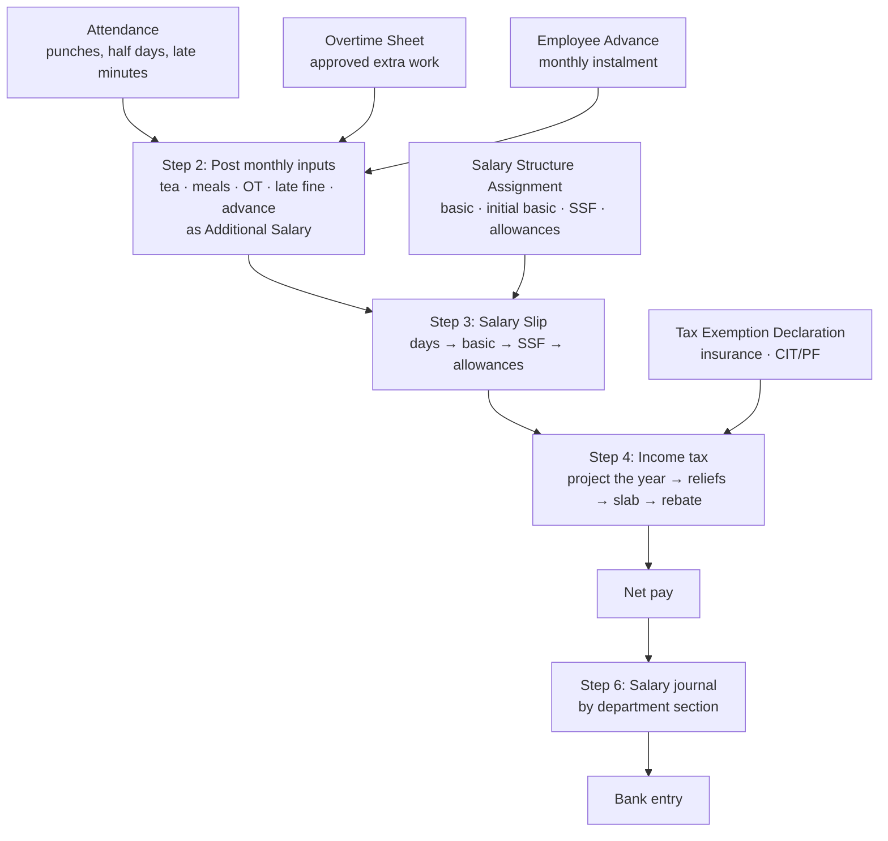
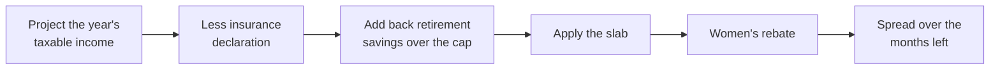
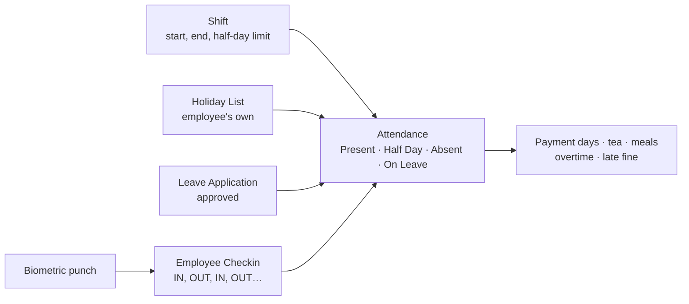

# Payroll calculation algorithm

> How the system turns attendance, pay and declarations into a salary slip, step by step, in the order the code runs it.
> Exact `file:line` for every step: [payroll-complete-reference.md](payroll-complete-reference.md) §2 and §5. A worked example with real numbers: [payroll-demo-walkthrough.md](payroll-demo-walkthrough.md) §4.

---

## Contents

1. [The whole flow at a glance](#1-the-whole-flow-at-a-glance)
2. [Step 1: Payroll Entry setup](#2-step-1-payroll-entry-setup)
3. [Step 2: Monthly inputs from attendance](#3-step-2-monthly-inputs-from-attendance)
4. [Step 3: The salary slip](#4-step-3-the-salary-slip)
5. [Step 4: Income tax](#5-step-4-income-tax)
6. [Step 5: Yearly payouts](#6-step-5-yearly-payouts)
7. [Step 6: Accounting](#7-step-6-accounting)
8. [Formula sheet](#8-formula-sheet)
9. [Worked example: the demo slip](#9-worked-example-the-demo-slip)
10. [Shifts, holidays and leave: what feeds the attendance](#10-shifts-holidays-and-leave-what-feeds-the-attendance)

---

## 1. The whole flow at a glance



| Step | When it runs | Main code |
|---|---|---|
| 1. Setup | Payroll Entry saved | `payroll/payroll_month.py`, `payroll/bs_period_guard.py` |
| 2. Inputs | **Create Salary Slips**, and again on **Submit Salary Slips** | `payroll/payroll_entry.py` `prepare_payroll_inputs` |
| 3. Slip | Every slip save | HRMS + `rdp_common_app` + our validate hooks |
| 4. Tax | Inside the slip save | HRMS + `payroll/tax_relief.py` + `payroll/income_tax.py` |
| 5. Payouts | A separate Payroll Entry with **Payout Type** | `payroll/special_payout.py` |
| 6. Books | **Submit Salary Slips**, then **Make Bank Entry** | `payroll/payroll_entry.py` `AvinashPayrollEntry` |

---

## 2. Step 1: Payroll Entry setup

**Input:** company, fiscal year, BS month.

```text
fill_from_bs_month
    start_date      = first day of the BS month
    end_date        = last day of the BS month
    posting_date    = end_date
    payable, cost   = the company's defaults
    employees       = everyone active with a submitted salary assignment

bs_period_guard
    refuse any date outside the posting date's BS month

check_ready_for_slips
    refuse, listing every name at once, if anyone has
        - no salary structure assignment, or
        - a department with no Payroll Section
```

> **Silent trap:** a blank payable account on someone's assignment drops that person from the run without a message.

---

## 3. Step 2: Monthly inputs from attendance

Runs on **Create Salary Slips** and again on **Submit Salary Slips**, so attendance fixed in between is picked up. Each result is posted as a **submitted Additional Salary**, which the slip then reads. Last run's lines for the month are removed first, including from draft slips.

### 3.1 The hourly rate

```text
month_days = days in the BS month (29 to 32)
hourly     = Basic ÷ month_days ÷ 8
```

The full monthly basic is used, over the calendar days of the month, not the working days.

### 3.2 Day by day

```text
FOR each submitted Attendance day of the employee in the month:

    TEA
      IF status is Present or Half Day:                (a worked holiday counts)
          tea_days += 1

    LATE
      IF full working day AND NOT Late Excused AND NOT a holiday:
          late_minutes += late entry + early exit       (no grace, no cap)

    OVERTIME
      IF the day is on a submitted Overtime Sheet with entitlement "Overtime":
          IF working day:  hours = time outside the shift, to the second
          IF holiday:      hours = first IN to last OUT
          ot_hours += hours                              (never rounded)

    MEAL
      IF employee is OT Eligible AND the day is on that Overtime Sheet:
          IF working day:
              meals += 1 if came in 1.5 h or more before the shift
              meals += 1 if stayed 1.5 h or more after the shift
          IF holiday:
              meals = 2 if worked 8 h or more
                      1 if worked 6 h or more
          meals = min(meals, Max Meals per Day)
```

### 3.3 What gets posted

| Line | Formula | Type | Tax |
|---|---|---|---|
| Tea | `tea_days × rate` | Earning | Full in this month |
| Meal | `meals × rate` | Earning | Full in this month |
| Overtime | `ot_hours × hourly × 1.5` | Earning | Full in this month |
| Late fine | `late_minutes ÷ 60 × hourly` | Deduction | — |
| Advance | see below | Deduction | — |

```text
ADVANCE, for each paid advance not yet recovered:
    IF the employee leaves this month:   recover everything still owed
    ELSE IF this month ≥ Recover From:   recover min(instalment, owed)
```

> **Rules:**
> - **Tea and meals:** paid only if the allowance has a row on the person's assignment.
> - **Overtime:** needs no assignment row. The OT Eligible tick and the Overtime Sheet decide it.
> - **Late fine:** applies to everyone not ticked **Late Fine Exempt**.

---

## 4. Step 3: The salary slip

### 4.1 Days

```text
working_days  = days in the BS month
                (minus holidays, if Payroll Settings leaves them out)
absent_days   = Absent days + ½ for each Half Day
payment_days  = working_days − absent_days
factor        = payment_days ÷ working_days
```

A day with no attendance counts as **Present**. Over 2 hours late makes the day a **Half Day** (½ absent), unless it is excused.

### 4.2 Structure rows (HRMS)

| Line | Formula | Cut by `factor`? |
|---|---|---|
| Basic | `base × factor` | Yes |
| SSF Addition | `Basic × 20%` if SSF applicable | Design: no |
| SSF (deduction) | `Basic × 31%` if SSF applicable | Design: no |

SSF is 31% in total: the company's 20% plus the employee's 11%. It is exempt from income tax.

> On `demo-nggroup` the SSF lines are cut by payment days, because their component setting differs from the design.

### 4.3 Our hooks, in this exact order

```text
1. add_employee_allowances      payroll/salary_slip.py
       FOR each allowance on the assignment:
           Monthly              → rate × factor
           % of Initial Basic   → initial_basic × rate% × factor
           Per Day / Meal / OT  → already on the slip from Step 2
           Entered by Hand      → only via Payroll Adjustment
           Yearly               → only via a payout run (Step 5)

2. apply_tax_reliefs            payroll/tax_relief.py        → Step 4
3. apply_income_tax_override    payroll/income_tax.py        manual tax, if ticked
4. bs_period_guard              dates inside the BS month
5. daily_breakdown              the day-by-day table on the slip
6. set_bs_dates                 Nepali date fields
```

> Any new hook that changes an amount must run **before** `apply_tax_reliefs`, or tax is worked out on the wrong figures.

### 4.4 Totals and the recovery cap

```text
gross = sum of earnings
net   = gross − SSF − late fine − advance − leave recovery − income tax

IF net < 0:                           (payroll/recovery_cap.py)
    cut Leave Recovery first, then the Advance, until net = 0
```

---

## 5. Step 4: Income tax

Every month, the system projects the **whole fiscal year** (Shrawan to Ashadh), taxes the year, and deducts the share still due.



### 5.1 Project the year

```text
remaining = BS months from this month to Ashadh, including this one

past      = taxable pay on this year's earlier slips
            + Taxable Earnings Till Date on the assignment (tax opening)
current   = this month's regular taxable pay (earnings − SSF)
future    = a full month's regular taxable pay × (remaining − 1)
one_off   = this month's full-tax lines (tea, meals, overtime, arrears)

annual    = past + current + future + one_off − exemption_declaration
```

### 5.2 Reliefs

| Relief | Rule | Where it is entered |
|---|---|---|
| Life insurance | up to **40,000** | Employee Tax Exemption Declaration |
| Health insurance | up to **20,000** | Employee Tax Exemption Declaration |
| Building insurance | up to **10,000** (demo holds 5,000: fix it) | Employee Tax Exemption Declaration |
| Retirement savings (SSF + CIT + PF) | not taxed up to **min(5,00,000, ⅓ of income)** | Automatic; CIT/PF on the declaration |
| Women's rebate | **10%** off the tax | Employee → Women's Tax Rebate tick |

```text
contributions = SSF for the whole year + declared CIT/PF
cap           = min(5,00,000, ⅓ × assessable income)
excess        = max(0, contributions − cap)
annual        = annual + excess            (above the cap is taxed again)
```

### 5.3 The FY 83/84 slab

| Yearly taxable income | Rate |
|---|---|
| Up to 10,00,000 | 1% — **waived for SSF members** |
| 10,00,001 – 15,00,000 | 10% |
| 15,00,001 – 25,00,000 | 20% |
| 25,00,001 – 40,00,000 | 27% |
| Above 40,00,000 | 29% |

The slab is read from the **salary assignment**, so a new fiscal year needs new assignments.

### 5.4 This month's deduction

```text
tax(x)      = slab(x) × (1 − women's rebate %, if ticked)

regular     = ( tax(annual − one_off) − tax already deducted this year ) ÷ remaining
full_tax    = tax(annual) − tax(annual − one_off)

Income Tax  = regular + full_tax

IF Override Income Tax is ticked:  Income Tax = the typed figure
```

---

## 6. Step 5: Yearly payouts

Run as **their own Payroll Entry** with **Payout Type** set. They get their own slips, journal and bank entry. No advances or fines are recovered on them.

| Payout | Formula | When |
|---|---|---|
| Dashain | `Basic × min(1, service days ÷ days in the year)` | Before Dashain |
| Leave encashment | `encashable days left × Basic ÷ BS month days` | Ashadh |
| Tax on either | `tax(year with the payout) − tax(year without it)` | On the payout slip |

---

## 7. Step 6: Accounting

```text
FOR each line on each slip:
    section = employee's Department → Payroll Section
    account = the component's account for that company and section

Salary journal (on Submit Salary Slips):
    Dr  expense accounts          Basic, HRA, allowances, overtime …
    Cr  SSF Payable               SSF
    Cr  TDS Payable               income tax
    Cr  Staff Advance             advance instalment
    Cr  fines account             late fine
    Cr  Salary Payable            net pay

Bank entry (Make Bank Entry):
    Dr  Salary Payable            net pay
    Cr  Bank
```

| Payroll Section | Expense accounts |
|---|---|
| Admin & Accounts | **O/O**, e.g. 547101 |
| Marketing (Sales) | **S/D**, e.g. 547102 |
| Plant (Factory) | **F/P**, e.g. 547103 |

To undo a month, cancel in reverse order: **bank entry → journal → slips → Payroll Entry**.

---

## 8. Formula sheet

| What | Formula |
|---|---|
| Payment days | `working days − absent − ½ × half days` |
| Factor | `payment days ÷ working days` |
| Basic on the slip | `base × factor` |
| SSF Addition | `Basic × 20%` |
| SSF deduction | `Basic × 31%` |
| HRA | `initial basic × rate% × factor` |
| Monthly allowance | `rate × factor` |
| Hourly basic | `Basic ÷ days in BS month ÷ 8` |
| Overtime | `OT hours × hourly × 1.5` |
| Late fine | `late minutes ÷ 60 × hourly` |
| Tea | `days present × rate` |
| Meal | `meals earned × rate` |
| Advance | `min(instalment, outstanding)`; everything if leaving |
| Dashain | `Basic × min(1, service days ÷ year days)` |
| Leave encashment | `days × Basic ÷ BS month days` |
| Retirement cap | `min(5,00,000, ⅓ × income)` |
| Payout tax | `tax(with) − tax(without)` |
| Net pay | `gross − all deductions`, never below 0 |

---

## 9. Worked example: the demo slip

`NGI-SAL-83/84-00029`, DEMO Ram Test, NGI, Ashwin 2083 on `demo-nggroup`. Basic 30,000, initial basic 20,000, SSF member.

| Step | Working | Result |
|---|---|---:|
| Days | 25 working − 2 absent − ½ half day | **22.5** payment days |
| Factor | 22.5 ÷ 25 | 0.9 |
| Basic | 30,000 × 0.9 | 27,000.00 |
| SSF Addition / SSF | 27,000 × 20% / × 31% *(demo cuts SSF)* | 5,400.00 / −8,370.00 |
| HRA | 20,000 × 25% × 0.9 | 4,500.00 |
| Education, Gas | 2,780 × 0.9, 1,690 × 0.9 | 2,502.00, 1,521.00 |
| Hourly basic | 30,000 ÷ 31 ÷ 8 | 120.97 |
| Overtime | (2 + 8.5 + 2.5) h × 120.97 × 1.5 | 2,358.87 |
| Late fine | 90 min ÷ 60 × 120.97 | −181.45 |
| Tea | 24 days × 235 | 5,640.00 |
| Meal | 2 × 75 (holiday worked 8.5 h) | 150.00 |
| Advance | min(2,000, 10,000) | −2,000.00 |
| **Gross** | | **49,071.87** |
| Income tax | year projects to 3,08,961.87, in the 1% band, waived for SSF | 0.00 |
| **Net pay** | 49,071.87 − 10,551.45 | **38,520.42** |

---

## 10. Shifts, holidays and leave: what feeds the attendance

Payroll only reads **Attendance**. Shifts, holidays and leave decide what each Attendance day says, so they run before every step above.



### 10.1 Shift: the yardstick for every minute

```text
shift(employee, date) =
    a submitted Shift Request covering the date        (temporary or permanent change)
    ELSE the active Shift Assignment                   (incl. monthly rotation)
    ELSE Employee → Default Shift

FOR the day's Attendance (biometric/attendance_override.py):
    late_entry  = first IN  − shift start    (if positive)
    early_entry = shift start − first IN     (if positive)
    early_exit  = shift end  − last OUT      (if positive)
    late_exit   = last OUT  − shift end      (if positive)

    Late Excused (Attendance form, or Monthly Attendance BS → Excuse ✎):
        minutes stay on record, not fined, no late half day

    IF first IN > shift start + "Half Day If Late By (Hours)"   (2 h on NGI shifts)
       AND not Late Excused AND not a holiday:
        status = Half Day, other half Absent
```

| Shift data | Used for |
|---|---|
| Start / end time | Late entry, early exit (late fine); early entry, late exit (meals, overtime on a working day) |
| Half Day If Late By (Hours) | Over this late = Half Day (in at 11:00 on a 9:00 shift stays Present; 11:01 is a Half Day) |
| Holiday List on the Shift Type | **Must stay blank.** It overrides every employee's own list |

Changing a shift for past days re-marks those days and re-measures their Overtime Sheets. It is refused if the salary for those days is already submitted.

### 10.2 Holidays: paid, and they change the rules for the day

```text
holiday_list(employee) = Employee → Holiday List
                         ELSE Company → Default Holiday List
(women follow the "(Women)" list: common days + Teej + Women's Day)

IF the date is on that list:
    no attendance needed: the day is paid
    working_days excludes it, if Payroll Settings leaves holidays out
    IF the person came in:
        Worked on Holiday = ticked automatically
        not late, not fined (there is no shift start to be late for)
        tea is paid
        overtime   = first IN → last OUT, only with an Overtime Sheet
        meals      = 8 h → 2, 6 h → 1, only with an Overtime Sheet
        Officer & Admin staff: Replacement Leave instead of overtime
```

| Holiday rule | Effect on pay |
|---|---|
| A holiday with no attendance | Paid in full |
| A holiday worked, OT-eligible, on an OT sheet | Tea + overtime for every hour + up to 2 meals |
| A holiday worked, Replacement Leave tick | Tea + one day of Replacement Leave instead of overtime |
| Holiday between two leave days | Counts as leave ("sandwich" rule) |
| Holiday added for a past date (Holiday Bulk Update) | That day's attendance is tidied: Worked on Holiday ticked, empty Absent rows removed |
| Holiday removed | Run **Attendance Fix** for that date |

On **1 Shrawan** everyone moves to the new year's lists by themselves, so those lists must exist before then.

### 10.3 Leave: credited by BS month, spent as On Leave

```text
CREDIT (every BS month end, hr/utils.allocate_earned_leaves_bs):
    Casual += 21 ÷ 12 = 1.75        (NGK: 8 ÷ 12)
    Sick   += 12 ÷ 12 = 1.00
    a mid-month joiner gets a share of that BS month
    never more than the year's policy figure (21 + 12, or 8 + 12 at NGK)

SPEND (Leave Application, once approved):
    the day's Attendance = On Leave
    paid leave type      → paid day      (payment days unchanged)
    Leave Without Pay    → unpaid day    (payment days − 1)
    half-day leave       → Half Day, other half the leave type → paid in full

    the balance may go negative (leave taken before it is credited)
    but never past the year's figure  → the rest must be Leave Without Pay

    came in on a day of approved leave → Half Day (half leave, half present)
```

| At year end or when someone leaves | Formula |
|---|---|
| Unused Casual and Sick (encashable) | Paid in Ashadh as **Leave Encashment**: `days × Basic ÷ BS month days` |
| Taken more than earned so far | Deducted on the last slip as **Leave Recovery**, same day rate |

### 10.4 How each status reaches the slip

| Attendance status | Payment day | Tea | Late fine | Notes |
|---|---:|:---:|:---:|---|
| Present | 1 | Yes | If late | |
| Work From Home | 1 | Yes | — | |
| Half Day (late or short hours) | ½ | Yes (full day) | No | Other half Absent |
| Half Day + leave for the other half | 1 | Yes | No | |
| On Leave (paid type) | 1 | No | — | |
| On Leave (Leave Without Pay) | 0 | No | — | |
| Absent | 0 | No | — | |
| Holiday, not worked | 1 | No | — | |
| Holiday, worked | 1 | Yes | No | Overtime and meals with an OT sheet |
| **No attendance on a working day** | **1** | No | — | "Consider unmarked attendance as" is **Present** |

> The last row is the biggest trap: a month with no attendance pays everyone in full and posts no tea, meals, overtime or fines. The Payroll Entry warns about it before making the slips.

**More detail:** [leave-management.md](leave-management.md) · [holiday-lists.md](holiday-lists.md) · [shift-rotation.md](shift-rotation.md) · [user-guide/03-attendance-leave-holidays.md](user-guide/03-attendance-leave-holidays.md)
