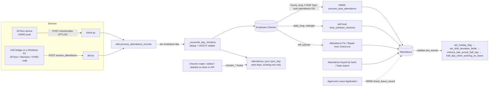

# 02 · Check-in → Attendance

How a finger on a biometric device becomes an **Employee Checkin**, and how check-ins become a submitted **Attendance** row with the fields payroll reads (status, half-day status, in/out, the four shift-deviation fields, Worked on Holiday, Late Excused).

Previous stage: [01-masters.md](01-masters.md) (Employee, Shift Type, Holiday List). Next: [03-shift-measurement.md](03-shift-measurement.md) (how the Attendance row is turned into late minutes and OT hours), then [04-overtime.md](04-overtime.md) and [05-payroll-entry.md](05-payroll-entry.md).
Related existing docs: [hrms-attendance-handoff.md](../hrms-attendance-handoff.md) (history and decisions), [user-guide/03-attendance-leave-holidays.md](../user-guide/03-attendance-leave-holidays.md) (HR steps), [salary-code-map.md](../salary-code-map.md) stages 1–2.

All "Config on avinas1" values were read from the database on **2026-10-12**.

---

## The stage in one picture

## What is live on avinas1 today (2026-10-12)

Read this first: the code path above is complete, but on `avinas1` most of it is idle.

| Fact | Value | Consequence |
|---|---|---|
| Biometric Device rows | **0** | [`assert_known_device`](../../avinashgroup_app/biometric/utils.py#L14) rejects every punch with HTTP 403 — no device can deliver. |
| Employee Checkin rows | **0** | Nothing for auto attendance, self-heal, Attendance Fix or Repair to work from. |
| Employees with `attendance_device_id` | **0 of 269** (265 Active, 4 companies) | Even a registered device's punches would be "skipped: Employee not found". |
| Shift Types | 2: `NGI 9:00 AM to 5:00 PM`, `NGK 9:00 AM to 5:00 PM` | Both `enable_auto_attendance = 0`, `last_sync_of_checkin = NULL`, `auto_update_last_sync = 0`. |
| Shift Assignments | **0** | Shift comes only from Employee `default_shift` (set on 4 employees). |
| System Settings `enable_scheduler` | **0** | No scheduled job runs on this site: self-heal, heartbeat, digest, OT `measure_pending`, BS leave accrual all last ran 2026-07-17 or never. |
| Attendance rows | **105**, all submitted, all company NGI, 4 employees (`NGI-EMP-00004/30/40/80`), dates 2026-07-17 → 2026-08-16 (Shrawan 2083); 102 Present, 1 Half Day, 2 Absent | All created by Administrator on 2026-10-09 09:45 within two seconds: seeded test attendance, keyed with in/out times and **working_hours = 0**. |
| Attendance Fix documents | 0 | — |
| Leave Applications | 0 | No On Leave rows exist yet. |
| Payroll Settings | `payroll_based_on = Attendance`, `consider_unmarked_attendance_as = Present`, `include_holidays_in_total_working_days = 1`, `consider_marked_attendance_on_holidays = 0`, `daily_wages_fraction_for_half_day = 0.5` | See [Unmarked days](#unmarked-days-are-paid-as-present). |

So on avinas1 the **only** source of attendance is hand entry / import (and Attendance Fix or Repair once punches exist). Everything below is documented as the code behaves; where the live state switches a path off, it says so.

---

## 1. Biometric Device (doctype)

| | |
|---|---|
| **What** | Registry of devices allowed to send punches. Fields: `device_name`, `device_serial` (the key every endpoint matches), `company`, `device_ip`, `enabled`, `connection_status`, `allowed_employees` (child **Biometric Device Allowed Employee**: `employee`, `company`, `device_user_id`), `last_contact_time`, `last_sync_time`, `total_synced`, `duplicate_threshold_seconds`, `alert_threshold_minutes`, `alert_recipients` (child **Biometric Device Alert Recipient**: `email`, `recipient_name`), `digest_recipients`, `notes`. Related: **Biometric Device Command** (`device`, `command_type`, `status`, `payload`, `result`, …). |
| **Why** | A punch carries only a device user number. The device's `company` is what makes that number mean one person (work numbers restart at 1 per company/HTMS install — commit `c3e8b19`, `2155b3d` "allow cross-company punches"). |
| **Where** | [`validate_allowed_employees`](../../avinashgroup_app/avinash_group_app/doctype/biometric_device/biometric_device.py#L13) refuses an allow-list where two rows claim one ID or an ID the host company already uses. |
| **Reads / Writes** | Read by every ingest endpoint; `last_sync_time` / `total_synced` written by [`_update_device_record`](../../avinashgroup_app/biometric/utils.py#L369); `last_contact_time` by [`ping`](../../avinashgroup_app/biometric/heartbeat.py#L101); `connection_status` by [`check_bridge_heartbeats`](../../avinashgroup_app/biometric/heartbeat.py#L26). |
| **Impacts** | Disabling a device (or changing its serial) makes all its punches 403 — they stay queued on the bridge, not lost. Changing `company` re-targets which employees its numbers resolve to. |
| **Config on avinas1** | 0 devices, 0 allowed employees, 0 alert recipients, 0 commands. |
| **Survives company deletion** | Listed in `company_data_to_be_ignored` in hooks.py. |

## 2. Ingest endpoints

### 2a. ZKTeco ADMS push — `/iclock/*`

| | |
|---|---|
| **What** | A Frappe page renderer that speaks the ZKTeco ADMS protocol. `GET cdata` returns a config block ([`_config_block`](../../avinashgroup_app/biometric/iclock.py#L112): `ATTLOGStamp=9999` = "send everything", `Realtime=1`); `POST cdata?table=ATTLOG` is parsed by [`_process_attlog`](../../avinashgroup_app/biometric/iclock.py#L129) into `{user_id, timestamp}` and handed to `process_attendance_records`; every other endpoint/table is answered `OK`. |
| **Why** | Module docstring: "Always returns plain-text 200 so a misbehaving device does not retry-storm." Errors go to Error Log, the device still gets `OK` so it clears its queue. |
| **Where** | Registered by [`page_renderer`](../../avinashgroup_app/hooks.py#L11) in hooks.py; [`IclockRenderer`](../../avinashgroup_app/biometric/iclock.py#L35), [`render`](../../avinashgroup_app/biometric/iclock.py#L39), [`_handle_cdata`](../../avinashgroup_app/biometric/iclock.py#L87). Log file `logs/iclock.log`. |
| **Gotcha** | An unregistered serial is **silently** dropped here (returns `OK`, logs a warning, writes an Error Log "Biometric Device Rejected"). The device thinks the data was delivered and will not resend it. |

### 2b. Bridge push — `receive_attendance`

| | |
|---|---|
| **What** | Whitelisted POST used by the K40 bridge: checks the serial, validates the JSON list, calls `process_attendance_records`, returns synced / skipped / failed punch IDs so the bridge knows what to retry. |
| **Where** | [`receive_attendance`](../../avinashgroup_app/biometric/api.py#L10). |
| **Why 403** | Docstring: matches heartbeat / command-tunnel / ADMS, which all gate on [`assert_known_device`](../../avinashgroup_app/biometric/utils.py#L14). |

### 2c. K40 bridge (Windows desktop app, in this repo)

| | |
|---|---|
| **What** | `k40_bridge/k40_bridge.py` (v[`VERSION`](../../k40_bridge/k40_bridge.py#L48) 1.6.7): a Tk/tray app on a LAN PC that reads punches from ZKTeco ([`ZKTecoClient`](../../k40_bridge/k40_bridge.py#L945)), Hikvision, or HTMS-86/HAMS Access databases ([`HtmsClient`](../../k40_bridge/k40_bridge.py#L1104)), de-duplicates locally ([`DedupStore`](../../k40_bridge/k40_bridge.py#L666)) and POSTs to the [`receive_attendance`](../../k40_bridge/k40_bridge.py#L54) endpoint through [`ErpnextClient`](../../k40_bridge/k40_bridge.py#L1489). It also pings the [`HEARTBEAT_PATH`](../../k40_bridge/k40_bridge.py#L58) every cycle and polls the command queue. |
| **Why** | The devices sit on factory LANs the ERP server cannot reach; the bridge is the only thing that can talk to them (bridge_commands docstring). Release = bump `latest_version.txt` and push; CI (`.github/workflows/build-k40-bridge.yml`) builds the installer. |
| **Gotcha** | HTMS `HAMS.mdb` can hold one `Emp_no` for several people — the bridge warns about it; the ERP side would attribute the punch to whichever Employee holds that `attendance_device_id` in the device's company. |

### 2d. Command tunnel and heartbeat

| Function | What | Trigger |
|---|---|---|
| [`enqueue_command`](../../avinashgroup_app/biometric/bridge_commands.py#L128) | Desk creates a **Biometric Device Command** (`force_sync` or `test_connection`, see [`SUPPORTED_COMMANDS`](../../avinashgroup_app/biometric/bridge_commands.py#L27)). | Button on Biometric Device form |
| [`poll_commands`](../../avinashgroup_app/biometric/bridge_commands.py#L31) | Bridge pulls Pending commands, server flips them to Running atomically. | Bridge, ~30 s |
| [`report_command_result`](../../avinashgroup_app/biometric/bridge_commands.py#L80) | Bridge reports Done/Failed + result. | Bridge |
| [`ping`](../../avinashgroup_app/biometric/heartbeat.py#L101) | Stamps `last_contact_time` on every sync cycle even when no punches — so a quiet device is distinguishable from a dead bridge. | Bridge |
| [`check_bridge_heartbeats`](../../avinashgroup_app/biometric/heartbeat.py#L26) | Hourly: compares `last_contact_time` with `alert_threshold_minutes`; emails Alert Recipients only on a Connected↔Disconnected **transition**. | `scheduler_events.hourly` ([`check_bridge_heartbeats`](../../avinashgroup_app/hooks.py#L529) in hooks.py) — **not running on avinas1** (scheduler disabled). |

### 2e. Midday attendance digest

| | |
|---|---|
| **What** | One email per company at 13:10 (Asia/Kathmandu): **A** Missed punches (odd punch count per day over a rolling window, holidays included, today excluded) — [`_missed_punches`](../../avinashgroup_app/biometric/daily_digest.py#L171); **B** Not seen today (rostered, shift started, no punch, no leave, not on holiday) — [`_not_seen_today`](../../avinashgroup_app/biometric/daily_digest.py#L218); **C** Device status — [`_device_status`](../../avinashgroup_app/biometric/daily_digest.py#L343). Recipients = devices' `digest_recipients`, pooled per company; none = no mail. Nothing is *sent* on a company holiday. [`preview_digest`](../../avinashgroup_app/biometric/daily_digest.py#L556) renders it on demand. |
| **Why** | Docstring: "a bridge that stopped three days ago looks exactly like a workforce that stopped punching." 13:10 not 13:00 so it does not race HRMS's hourly auto attendance (self-heal runs at midnight, so past days are already repaired) (comment above [`send_daily_attendance_digest`](../../avinashgroup_app/hooks.py#L577) in hooks.py). |
| **Where** | [`send_daily_attendance_digest`](../../avinashgroup_app/biometric/daily_digest.py#L76), [`build_digest`](../../avinashgroup_app/biometric/daily_digest.py#L139). |
| **Config on avinas1** | Never run (scheduler disabled; no devices → no recipients). |

## 3. From punches to Employee Checkin

### 3a. `process_attendance_records`

| | |
|---|---|
| **What** | Groups the batch by (device user ID, calendar date); for each group, under its own savepoint: resolves the employee, merges with existing checkins, inserts the new ones, relabels IN/OUT, then syncs the day's existing attendance. Returns synced / skipped (permanent: unknown user, bad timestamp) / failed (transient: exception, safe to retry). |
| **Where** | [`process_attendance_records`](../../avinashgroup_app/biometric/utils.py#L107); timestamp formats in [`_parse_timestamp`](../../avinashgroup_app/biometric/utils.py#L356) (`%Y-%m-%d %H:%M:%S`, `T`-separated, ISO). |
| **Why savepoint per group** | Inline comment: a failure halfway through one person-day must not leave half its punches committed and still be reported as retryable. |
| **Reads** | Biometric Device `name`, `company`, `duplicate_threshold_seconds`. |
| **Writes** | Employee Checkin; Biometric Device `last_sync_time`, `total_synced`. |

### 3b. Which employee a punch belongs to — `resolve_employee_for_punch`

| | |
|---|---|
| **What** | (1) Employee of the **device's company** whose `attendance_device_id` = the user ID (a device with no company matches across all companies — legacy). (2) Only on a miss: the device's Allowed Employees list (explicit `device_user_id` first, else the visitor's own `attendance_device_id`). |
| **Where** | [`resolve_employee_for_punch`](../../avinashgroup_app/biometric/utils.py#L48). Uniqueness enforced at save time by [`validate_unique_device_id`](../../avinashgroup_app/biometric/employee.py#L13) (Employee `validate`, registered in hooks.py at [`validate_unique_device_id`](../../avinashgroup_app/hooks.py#L347)). |
| **Why** | Same work number repeats across companies; within one company it must be unique "so the matching side never has to guess" (docstring). |
| **Impacts** | Changing an employee's `attendance_device_id` or `company` re-routes future punches only; checkins already stored keep their employee. |

### 3c. De-duplication and IN/OUT labelling — `_reconcile_day_checkins`

| | |
|---|---|
| **What** | Existing checkins of the day are always kept. A new punch is dropped if it equals an existing time, or is within `duplicate_threshold_seconds` of any kept punch (default [`DEFAULT_DUPLICATE_THRESHOLD_SECONDS`](../../avinashgroup_app/biometric/utils.py#L11) = 60). Then every punch of the day is labelled by [`desired_log_type`](../../avinashgroup_app/biometric/attendance_sync.py#L57): IN, OUT, IN, … in time order, **the last punch forced to OUT** when there are ≥ 2. New rows get `custom_company` = employee's company, `device_id` = device serial, `skip_auto_attendance = 0`. Finally [`sync_day`](../../avinashgroup_app/biometric/attendance_sync.py#L241) runs once for the day. |
| **Where** | [`_reconcile_day_checkins`](../../avinashgroup_app/biometric/utils.py#L270); the per-insert checkin hooks are suppressed with [`in_biometric_day_reconcile`](../../avinashgroup_app/biometric/utils.py#L323) so the day is synced once, not per punch. |
| **Why last = OUT** | `desired_log_type` docstring: with an odd punch count (forgot a midday punch) plain alternation labels the last punch IN and the attendance loses its real out-time. Forcing OUT keeps in = first, out = last. |
| **Gotcha** | The docstring says the site runs "Strictly based on Log Type"; on avinas1 both Shift Types are actually **"Alternating entries as IN and OUT during the same shift"**, where HRMS ignores `log_type` and pairs by position. The relabel is therefore cosmetic for HRMS's hours, but it is what the Attendance form's Checkin Log and the digest show. |
| **Gotcha** | Grouping is by **calendar date** — a night shift crossing midnight would be split into two days (all current shifts are day shifts, 09:00–17:00). |

### 3d. Employee Checkin custom fields

| Field | Created by | Written by | Read by |
|---|---|---|---|
| `custom_company` (Link Company) | patch `add_company_to_employee_checkin` ([`custom_company`](../../avinashgroup_app/patches/add_company_to_employee_checkin.py#L18)) | `_reconcile_day_checkins` | company filters / reports |

Stock fields used: `employee`, `time`, `log_type`, `device_id`, `shift`, `shift_start/end`, `shift_actual_start/end` (set by HRMS [`fetch_shift`](../../../hrms/hrms/hr/doctype/employee_checkin/employee_checkin.py#L64)), `attendance` (link), `skip_auto_attendance` (HRMS's "poison" flag).

### 3e. Checkins made, edited or deleted outside the device pipeline

| Hook | Handler | What |
|---|---|---|
| Employee Checkin `before_validate` | [`checkin_before_validate`](../../avinashgroup_app/biometric/attendance_sync.py#L333) | A linked punch whose time changes on a past, re-markable day loses its attendance link, so HRMS's "cancel the attendance first" check passes; the day is rebuilt in `on_update`. On a day inside a submitted salary slip it throws, naming the slip. |
| Employee Checkin `after_insert` | [`checkin_after_insert`](../../avinashgroup_app/biometric/attendance_sync.py#L350) | Relabel the day. A past-day punch without a `device_id` is a hand entry: stamped (`custom_time_edited`, reason "Added on Employee Checkin form") and the day re-marked by [`remark_from_form`](../../avinashgroup_app/hr/punch_correction.py#L446). Today, device punches, and days the correction refuses: `sync_day` as before. Skipped while the device pipeline is inserting. |
| Employee Checkin `on_update` | [`checkin_on_update`](../../avinashgroup_app/biometric/attendance_sync.py#L371) | Time changed: stamped (device's reading kept) and both the old and the new day re-marked. `log_type` only: relabel and `sync_day`. Not on insert. |
| Employee Checkin `after_delete` | [`checkin_after_delete`](../../avinashgroup_app/biometric/attendance_sync.py#L405) | Relabel and re-mark the day from what is left (no punches left: the attendance is kept, with a warning). |

Registered in a loop in hooks.py ([`attendance_sync.checkin_`](../../avinashgroup_app/hooks.py#L341)). **Why** (hooks.py comment and module docstring of `attendance_sync.py`): keep IN/OUT alternation right "no matter how punches arrive", and make a hand change to a past day's punches count: the day is rebuilt the same way the Monthly Attendance BS correction rebuilds it (punches pinned to the rostered shift, `reconcile_employee_day`, Overtime Sheet rows re-measured, comment on the Attendance). Status therefore can change on a hand edit; device pushes still only reach `sync_day`, which never changes status. Rebuilt inline on a form save (so the report shows it at once), in a deduplicated background job under Data Import. Manual `log_type` choices are deliberately overwritten by [`relabel_day_checkins`](../../avinashgroup_app/biometric/attendance_sync.py#L84).

### 3f. `sync_day` and `refresh_attendance_values`

| | |
|---|---|
| **What** | Past dates only (today belongs to the realtime flow). If the day has a **Present or Half Day** Attendance (draft or submitted): link its orphan checkins (clearing stale `skip_auto_attendance`), resolve the shift (row's shift, else the majority of the checkins' shifts, else Default Shift — [`_resolve_shift_doc`](../../avinashgroup_app/biometric/attendance_sync.py#L291)), and [`refresh_attendance_values`](../../avinashgroup_app/biometric/attendance_sync.py#L172): rerun HRMS `ShiftType.get_attendance` over all punches and write only changed `working_hours`, `late_entry`, `early_exit`, `in_time`, `out_time`, plus the four deviation fields via [`compute_shift_deviations`](../../avinashgroup_app/biometric/attendance_sync.py#L138) when in/out moved. |
| **Writes** | `frappe.db.set_value` on Attendance — works on submitted rows, **does not run validate**. |
| **Why precision** | Comment at [`get_field_precision`](../../avinashgroup_app/biometric/attendance_sync.py#L213): Attendance.working_hours is 1 dp on hrms 15.49.2; comparing unrounded values rewrote every row every hour forever. |
| **Gotcha** | Because it bypasses validate, a corrected in-time does **not** re-run the >2 h late rule or the holiday flag: a day already demoted to Half Day stays Half Day even if an earlier punch arrives later, and vice versa. Use Repair from Check-ins / Attendance Fix (which rebuild Absent rows only) or cancel + amend. Absent / On Leave / WFH days and days with no row are left alone. |

## 4. Check-ins → Attendance: who creates the row

Four creators, one primitive set. Whatever creates the row, the same Attendance `validate` hooks (section 5) run on it.

### 4a. HRMS auto attendance (stock) — OFF on avinas1

| | |
|---|---|
| **What (stock HRMS)** | `hourly_long`: [`update_last_sync_of_checkin`](../../../hrms/hrms/hooks.py#L224) then [`process_auto_attendance_for_all_shifts`](../../../hrms/hrms/hooks.py#L225) → for each Shift Type with auto attendance, [`process_auto_attendance`](../../../hrms/hrms/hr/doctype/shift_type/shift_type.py#L101): needs `enable_auto_attendance`, `process_attendance_after` and `last_sync_of_checkin`; takes unlinked, non-skipped checkins whose shift ended before last sync ([`get_employee_checkins`](../../../hrms/hrms/hr/doctype/shift_type/shift_type.py#L153)); skips holidays unless `mark_auto_attendance_on_holidays` ([`should_mark_attendance`](../../../hrms/hrms/hr/doctype/shift_type/shift_type.py#L336), using the **Shift Type's holiday list first** — [`get_holiday_list`](../../../hrms/hrms/hr/doctype/shift_type/shift_type.py#L332)); status from hour thresholds in [`get_attendance`](../../../hrms/hrms/hr/doctype/shift_type/shift_type.py#L179); creates a **submitted** Attendance with [`mark_attendance_and_link_log`](../../../hrms/hrms/hr/doctype/employee_checkin/employee_checkin.py#L197) (on any ValidationError it sets `skip_auto_attendance=1` on the logs forever — [`handle_attendance_exception`](../../../hrms/hrms/hr/doctype/employee_checkin/employee_checkin.py#L360)); then marks **Absent** every assigned employee-day with no attendance between Process Attendance After and last sync ([`mark_absent_for_dates_with_no_attendance`](../../../hrms/hrms/hr/doctype/shift_type/shift_type.py#L218)). |
| **What we change** | Nothing in the class. We add hooks on the Attendance it creates (section 5) and the self-heal net (4b). |
| **Config on avinas1** | Both Shift Types: `enable_auto_attendance = 0`, `last_sync_of_checkin = NULL`, `auto_update_last_sync = 0`, thresholds for half day / absent = **0** (off — patch `remove_working_hours_threshold`), `enable_late_entry_marking = 0`, `enable_early_exit_marking = 0`, `mark_auto_attendance_on_holidays = 0`, `working_hours_calculation_based_on = First Check-in and Last Check-out`; check-in window NGI 180 min before / 240 after, NGK 60 / 60; `process_attendance_after` NGI 2026-10-09, NGK 2026-06-29; NGK carries `holiday_list = NGK-Holiday-00001` (the **82/83** list, ending 2026-07-16), NGI none. |
| **Consequences of OFF** | No row is created from punches automatically; **nobody is ever auto-marked Absent**; with `consider_unmarked_attendance_as = Present` every unmarked working day is paid. Self-heal also refuses to act (it requires auto attendance on). Attendance can only come from hand entry, import, Attendance Fix or Repair. Also, because thresholds are 0, HRMS's own status is always Present — Half Day / Absent come only from our late rule, leave, or hand entry. |
| **Turning it ON needs** | `enable_auto_attendance = 1` **and** a `last_sync_of_checkin` (or `auto_update_last_sync = 1`), **and** the scheduler enabled for the site. Clear NGK's stale Shift-Type holiday list first, or 83/84 holidays will be treated as working days (and absentees marked Absent on them). [hrms-attendance-handoff.md](../hrms-attendance-handoff.md) describes three Shift Types switched on with "Strictly based on Log Type", 4 h / 2 h thresholds and 15-min grace — **that does not match avinas1 today** (likely another site or an earlier state). |

### 4b. Daily self-heal — `heal_unlinked_checkins`

| | |
|---|---|
| **What** | Every (employee, day) in the last [`LOOKBACK_DAYS`](../../avinashgroup_app/biometric/attendance_self_heal.py#L49) = 45 days (up to yesterday) with unlinked checkins, at most [`MAX_GROUPS_PER_RUN`](../../avinashgroup_app/biometric/attendance_self_heal.py#L55) = 3000 per run, goes through `reconcile_employee_day` with `include_skipped=True`, `mark_absent_when_no_checkins=False`, and **no holiday skip** (punches on holidays still count). |
| **Why** | Docstring failure modes F1–F3: punches arriving after HRMS marked the day Absent (HRMS poisons them), any ValidationError poisoning logs, punches stored before a shift existed. "Deliberately narrow: it never marks anyone Absent." |
| **Gates** | Skips a group unless the shift (majority of checkins' shifts, else Default Shift — [`_resolve_shift`](../../avinashgroup_app/biometric/attendance_self_heal.py#L144)) has [`enable_auto_attendance`](../../avinashgroup_app/biometric/attendance_self_heal.py#L95) on, a `last_sync_of_checkin`, the day is on/after `process_attendance_after`, and the shift + checkout buffer ended before last sync ([`_shift_window_closed`](../../avinashgroup_app/biometric/attendance_self_heal.py#L170)). |
| **Where / trigger** | [`heal_unlinked_checkins`](../../avinashgroup_app/biometric/attendance_self_heal.py#L58), `scheduler_events.daily_long`, midnight ([`heal_unlinked_checkins`](../../avinashgroup_app/hooks.py#L542) in hooks.py). Was `hourly_long` until 2026-10-13: it only repairs days before today, so an hourly pass gained nothing over a nightly one. |
| **Config on avinas1** | Inert twice over: scheduler disabled, and both shifts have auto attendance off and no last sync. |
| **Important consequence** | HRMS never auto-marks holidays, so **holiday work is turned into attendance only by self-heal or by the Repair button** (Attendance Fix skips holidays, see 4c). With self-heal inert, holiday work needs Repair or hand entry. |

### 4c. Attendance Fix (bulk, HR-submitted)

| | |
|---|---|
| **What** | Submittable doctype: Shift Type + Company + From/To + Repair Scope ("All Employees in Shift" via HRMS [`get_assigned_employees`](../../../hrms/hrms/hr/doctype/shift_type/shift_type.py#L309), or "Selected Employees" from child **Attendance Fix Employee**) + optional **Attendance Fix Device** filter. On submit it enqueues [`run_attendance_fix_in_background`](../../avinashgroup_app/avinash_group_app/doctype/attendance_fix/attendance_fix.py#L448) on the `long` queue (4 h timeout), which walks every employee × date through [`reconcile_employee_day`](../../avinashgroup_app/avinash_group_app/doctype/attendance_fix/attendance_fix.py#L266) and writes status, progress %, counters and a per-day log. Inactive employees are skipped ([`_resolve_employees`](../../avinashgroup_app/avinash_group_app/doctype/attendance_fix/attendance_fix.py#L188)). |
| **Per-day rules** (`reconcile_employee_day`) | Holiday (employee list, else company default — [`_get_holiday_dates`](../../avinashgroup_app/avinash_group_app/doctype/attendance_fix/attendance_fix.py#L504)) → **skip the day entirely** ([`holiday_dates`](../../avinashgroup_app/avinash_group_app/doctype/attendance_fix/attendance_fix.py#L291)). No checkins and no row → [`mark_attendance`](../../avinashgroup_app/avinash_group_app/doctype/attendance_fix/attendance_fix.py#L334) **Absent**. No checkins, row exists → leave it. Checkins + non-Absent row → link orphans, refresh values for Present/Half Day (status untouched). Checkins + Absent row → cancel & delete the Absent, build a new row with HRMS `get_attendance` + `mark_attendance_and_link_log`. Checkins + no row → create. Checkins that do not resolve to *this* Shift Type are ignored ([`prepare_checkins_for_shift`](../../avinashgroup_app/biometric/attendance_sync.py#L105)). |
| **Why** | Module docstring: "manual repair tool for offline-bridge gaps", reusing stock primitives "so attendance status / working-hours computation matches everywhere else". Background because a wide range runs every Attendance hook thousands of times. [`validate_selected_employees`](../../avinashgroup_app/avinash_group_app/doctype/attendance_fix/attendance_fix.py#L46) warns when a named employee is not on the chosen shift. |
| **Impacts** | **This is the only code path on the site that creates Absent rows from an empty day.** Absent rows reduce payment days (see [06-salary-slip.md](06-salary-slip.md)); with unmarked = Present, running Attendance Fix over a period where punches are missing turns paid days into unpaid ones. |
| **Gotcha — docs vs code** | [user-guide/10-troubleshooting.md](../user-guide/10-troubleshooting.md) says "Someone worked on a Saturday or holiday but has no attendance … run Attendance Fix for that date", and [user-guide/03](../user-guide/03-attendance-leave-holidays.md) lists "a holiday was added … for a past date" as an Attendance Fix case. The code skips holiday dates before looking at punches, so **Attendance Fix never creates holiday-work attendance**. Only Repair from Check-ins (4d), self-heal, or hand entry do. |
| **Config on avinas1** | 0 documents. |

### 4d. Repair from Check-ins (one day, from the Attendance form)

| | |
|---|---|
| **What** | Button added by [`add_repair_button`](../../avinashgroup_app/public/js/attendance.js#L85) (doctype_js, [`public/js/attendance.js`](../../avinashgroup_app/hooks.py#L107) in hooks.py) calling [`repair_attendance_day`](../../avinashgroup_app/avinash_group_app/doctype/attendance_fix/attendance_fix.py#L524): HR Manager / System Manager only; same `reconcile_employee_day` with **no shift gates**, **no holiday skip**, `include_skipped=True`, and never marks Absent. Reports before/after; if a stale Absent was replaced the form routes to the new document. |
| **Why** | Docstring: single-record counterpart to Attendance Fix; "Creating an Absent from an empty day is a payroll decision; this button exists to make attendance agree with the punches." |
| **Also on the form** | [`render_checkin_log`](../../avinashgroup_app/public/js/attendance.js#L14): a table of the day's checkins (IN = Checkin, OUT = Checkout) under the status field. |

### 4e. Hand entry, import, and [`get_shift_roster`](../../avinashgroup_app/avinash_group_app/doctype/attendance_fix/attendance_fix.py#L630)

Attendance can be created on the desk or by Data Import. It still passes through section 5's hooks, so a hand-made row with an `in_time` still gets its shift filled, deviations computed and the late rule applied. Hand-made rows carry `working_hours = 0` unless typed (HRMS does not derive hours from in/out on a manual save) — all 105 rows on avinas1 are like this, which matters for holiday OT (see [03-shift-measurement.md](03-shift-measurement.md)). `get_shift_roster` seeds Attendance Fix's Selected Employees table.

---

## 5. Attendance `validate`: HRMS first, then our four hooks

HRMS `Attendance.validate` ([`validate`](../../../hrms/hrms/hr/doctype/attendance/attendance.py#L41)) runs first: date/joining checks, [`validate_duplicate_record`](../../../hrms/hrms/hr/doctype/attendance/attendance.py#L67) (one row per employee-day, half-day-leave exceptions), overlapping shift, employee status, and [`check_leave_record`](../../../hrms/hrms/hr/doctype/attendance/attendance.py#L154): an **approved, submitted Leave Application** covering the date sets `leave_type`, `leave_application` and status **On Leave** (or **Half Day** on its half-day date). Then our doc_events run, in the order registered at [hooks.py `attendance_events`](../../avinashgroup_app/hooks.py#L228).

Why `validate` and not `before_save` (hooks.py comment): auto attendance inserts already-submitted rows, and Frappe runs `before_submit`, not `before_save`, on that path; `validate` fires on both.

| # | Hook | What it does | Reads | Writes |
|---|---|---|---|---|
| 1 | [`set_holiday_flag`](../../avinashgroup_app/payroll/attendance_allowance.py#L531) | Ticks `custom_worked_on_holiday` if the date is in the employee's Holiday List, else the company's `default_holiday_list`. Set regardless of status (an Absent on a holiday is also flagged). | Employee `holiday_list`, Company `default_holiday_list`, Holiday | `custom_worked_on_holiday` |
| 2 | [`set_shift_deviation_fields`](../../avinashgroup_app/biometric/attendance_override.py#L8) | If the row has no shift, fills it from the roster ([`get_shift_window`](../../avinashgroup_app/biometric/attendance_override.py#L38): dated Shift Assignment, else Default Shift). Then writes the four deviation fields via `compute_shift_deviations`. | Shift Type `start_time`, `end_time` | `shift`, `custom_late_entry`, `custom_early_entry`, `custom_early_exit`, `custom_late_exit` |
| 3 | [`enforce_late_arrival_half_day`](../../avinashgroup_app/biometric/attendance_override.py#L55) | If `custom_late_excused` → [`_undo_excused_late_half_day`](../../avinashgroup_app/biometric/attendance_override.py#L115). Else, for a row not already On Leave / Absent / Half Day: cutoff = shift start + [`custom_half_day_if_late_by_hours`](../../avinashgroup_app/biometric/attendance_override.py#L95) (0 or blank → rule off). `in_time` strictly after it → Half Day, [`half_day_status = "Absent"`](../../avinashgroup_app/biometric/attendance_override.py#L105), `leave_type` cleared. | Shift Type `custom_half_day_if_late_by_hours`, `working_hours_threshold_for_half_day` | `status`, `half_day_status`, `leave_type` |
| 4 | [`half_day_when_working_on_leave`](../../avinashgroup_app/biometric/attendance_override.py#L141) | On Leave from a Leave Application **and** an `in_time` → Half Day, `half_day_status = "Present"`, leave type kept. | `leave_application`, `in_time` | `status`, `half_day_status` |

**Why** each rule exists:

- **Holiday flag** — feeds the holiday rules in payroll (tea not paid on holidays, holiday meals by hours (6 h → 1, 8 h → 2), Worked on Holiday components), holiday OT measurement and the holiday reports. Kept in step with the list by [`resync_holiday_flags`](../../avinashgroup_app/payroll/attendance_allowance.py#L556) on every Holiday List save (only the changed dates, up to today, only that list's employees). Backfill/recompute: [`recompute_holiday_flags`](../../avinashgroup_app/payroll/attendance_allowance.py#L604) (whitelisted; for rows that went stale before that hook existed). Monthly Attendance BS counts Worked on Holiday from the list itself (`worked_on_holiday`), in both views. Created by patch `setup_attendance_allowance` ([`custom_worked_on_holiday`](../../avinashgroup_app/patches/setup_attendance_allowance.py#L98)).
- **Deviation fields** — "late time, meals and the half-day rule all silently read nothing" without a shift (comment in `set_shift_deviation_fields`). Fields created by patch `add_site_only_hr_fields` ([`custom_late_entry`](../../avinashgroup_app/patches/add_site_only_hr_fields.py#L46)) (they existed only as site data until the 2026-09-27 audit).
- **>2 h late = Half Day** — policy 1.2, client meeting 2026-09-15, no grace period (docstring; commit `3bbf272`). Hours-after-start replaced the absolute cutoff because cutoffs had to be retyped per shift and two shifts carried a stray 11:24:33 (commit `3bbf272`). It is HRMS's **half-absent**, not a leave type (commit `08672a0`; patch `late_half_day_as_half_absent` ([`execute`](../../avinashgroup_app/patches/late_half_day_as_half_absent.py#L22)) removed the short-lived "Late Half Day" leave type and converted rows). The slip counts it through HRMS [`get_half_absent_days`](../../../hrms/hrms/payroll/doctype/salary_slip/salary_slip.py#L544) × `daily_wages_fraction_for_half_day` (0.5). Field from patch `setup_late_half_day_rule` ([`custom_half_day_if_late_by_hours`](../../avinashgroup_app/patches/setup_late_half_day_rule.py#L25)).
- **Late Excused** — patch `setup_late_excuse` ([`custom_late_excused`](../../avinashgroup_app/patches/setup_late_excuse.py#L27)): rules are blind to "the landslide on the highway or the funeral"; lateness stays recorded, is not fined, and a day demoted *only* by lateness goes back to Present (not if the hours are also below the half-day threshold — currently 0, so always restored). Reason is mandatory.
- **Working on leave = Half Day** — policy 3.4 (2026-09-15): "Reporting to office while on leave counts as a half day"; HRMS never looks at punches on a leave day (commit `3bbf272`). The leave half is still deducted from the balance / LWP by the leave type.

**Worked example on avinas1** — `NGI-ATT-83/84-00059`, NGI-EMP-00030, 2026-07-23, shift NGI 09:00–17:00: in 11:15 → `custom_late_entry` = 8100 s (2 h 15 m) > 2 h → **Half Day, half_day_status Absent**; the slip will treat it as 0.5 day absent. Compare `NGI-ATT-83/84-00017` (in 09:40, late 2400 s = 40 min) → stays Present, 40 late minutes feed the late fine (see [03](03-shift-measurement.md)).

### Attendance custom fields (all on Attendance)

| Field | Type | Created by | Written by | Read by |
|---|---|---|---|---|
| `custom_worked_on_holiday` | Check (read-only) | `setup_attendance_allowance` | `set_holiday_flag`, `recompute_holiday_flags`, `holiday_backdate.follow_up` | `evaluate_rule` (Worked on Holiday, tea Pay on Holiday, meals), `measure_day`, reports, `daily_breakdown` |
| `custom_late_entry` / `custom_early_entry` / `custom_early_exit` / `custom_late_exit` | Duration (seconds, rounded to the minute by [`_round_to_minute`](../../avinashgroup_app/biometric/attendance_sync.py#L130)), read-only | `add_site_only_hr_fields` | `set_shift_deviation_fields`, `refresh_attendance_values` | `measure_day`, `evaluate_rule` (Late Time, meals, Early Entry / Late Stay / Late Arrival), reports, OT settlement |
| `custom_late_excused` | Check | `setup_late_excuse` | HR | `enforce_late_arrival_half_day`, `evaluate_rule` |
| `custom_late_excuse_reason` | Small Text, mandatory when excused | `setup_late_excuse` | HR | audit only |

**Gotcha — Late Excused on a submitted row.** `custom_late_excused` is **not** `allow_on_submit` (checked in `tabCustom Field`). Every row from auto attendance, Attendance Fix or Repair is submitted on insert, so HR cannot simply "tick and save" as [user-guide/03 §3.3](../user-guide/03-attendance-leave-holidays.md) says: the row must be cancelled and amended (new name), and Prepare Payroll Inputs re-run for the month. (Desk behaviour not exercised — unverified beyond the field definition.)

**No late rule on holidays** (2026-10-15). `enforce_late_arrival_half_day` returns early when `custom_worked_on_holiday` is set, `measure_day` counts no late minutes on a holiday, and the "Late Arrival After" condition pays no fine there. Before, a holiday worker arriving > 2 h after the normal shift start became Half Day / half-absent (Abhishek NGI-EMP-00037, 8 Aug); rows marked before the change keep that status until the day is re-marked.

**Gotcha — HRMS typo.** In `check_leave_record`, a Half Day / On Leave row without a leave record is meant to get `half_day_status = Absent`, but HRMS writes [`haf_day_status`](../../../hrms/hrms/hr/doctype/attendance/attendance.py#L195). A hand-entered Half Day therefore has whatever `half_day_status` HR chose; only our late rule sets it reliably.

---

## 6. Unmarked days, leave, holidays

### Unmarked days are paid as Present

`Payroll Settings.consider_unmarked_attendance_as = Present`. HRMS [`get_unmarked_days`](../../../hrms/hrms/payroll/doctype/salary_slip/salary_slip.py#L529) only deducts unmarked days when this is Absent. With auto attendance off and no Absent marking anywhere except Attendance Fix, **a day with no Attendance costs nothing, and earns no tea / meal / OT / late fine** (those are counted from Attendance rows — [05-payroll-entry.md](05-payroll-entry.md)). `payroll_month.warn_missing_attendance` warns about employees with no attendance in the month. The day-by-day slip table applies the same rule in [`paid_weight`](../../avinashgroup_app/payroll/daily_breakdown.py#L215).

### Leave

Approved Leave Application → `check_leave_record` → On Leave (or Half Day on the half-day date). Pay effect depends on the Leave Type (`is_lwp`) — see [06-salary-slip.md](06-salary-slip.md). Gender rules, ceilings and BS accrual are in [01-masters.md](01-masters.md) / [08-changes-over-time.md](08-changes-over-time.md). avinas1 has no Leave Applications yet.

### Holidays

| Path | What happens on a holiday |
|---|---|
| HRMS auto attendance | Skips the day (`mark_auto_attendance_on_holidays = 0`) — punches stay unlinked. |
| Self-heal, Repair | Pair the punches anyway → Present/Half Day with Worked on Holiday ticked. |
| Attendance Fix | Skips the day completely. |
| Absent on a holiday | Ignored by payroll (`consider_marked_attendance_on_holidays = 0`); holidays are paid (`include_holidays_in_total_working_days = 1`). |
| Holiday added for a **past** date (Holiday Bulk Update) | [`follow_up`](../../avinashgroup_app/hr/holiday_backdate.py#L51) (called from Holiday Bulk Update, [`follow_up(self.holiday_date`](../../avinashgroup_app/avinash_group_app/doctype/holiday_bulk_update/holiday_bulk_update.py#L60)): ticks Worked on Holiday on worked rows, deletes Absent rows with no punches and no leave, leaves leave rows alone, skips employees with a submitted slip covering the date (named in the report), lists — does not rewrite — approved Overtime Sheets for the date. |

Which list: the employee's `holiday_list`, else the company's `default_holiday_list` (everywhere in our code). HRMS auto attendance prefers the **Shift Type's** holiday list. On avinas1 only 4 companies have a default list (NGI/NGG/NGK/NGN → their 83/84 lists); GLMI, GEPL, SGU have none, and SGU/GEPL/GLMI have no 83/84 list at all; only 21 of 269 employees have a personal list. Women's lists (`… Women 83/84`) exist for NGI/NGG/NGK/NGN — see [01-masters.md](01-masters.md) and [holiday-lists.md](../holiday-lists.md).

---

## 7. Backdated shift changes re-mark attendance

| | |
|---|---|
| **What** | When a Shift Request / Shift Assignment reaches into past days, those days' attendance is rebuilt on the new shift: leave rows and no-punch rows keep status (shift corrected); days with punches are deleted and re-marked through `reconcile_employee_day`; approved Overtime Sheet rows re-measured ([`_remeasure_overtime`](../../avinashgroup_app/hr/shift_backdate.py#L356)). Before cancel/split the covered days are detached ([`detach_days`](../../avinashgroup_app/hr/shift_backdate.py#L193)) because HRMS refuses to cancel an assignment whose shift is still named by attendance or checkins. |
| **Guard** | [`guard_paid_period`](../../avinashgroup_app/hr/shift_backdate.py#L80) (validate): refuses a change overlapping a **submitted Salary Slip** — "Cancel the salary slip first". |
| **Where / trigger** | Hooks in hooks.py from [`guard_paid_period`](../../avinashgroup_app/hooks.py#L446) to line 439: Shift Request validate / before_submit / on_submit / before_cancel / on_cancel; Shift Assignment validate / on_submit / before_cancel / on_cancel → [`rebuild_for_request`](../../avinashgroup_app/hr/shift_backdate.py#L140), [`rebuild_for_assignment`](../../avinashgroup_app/hr/shift_backdate.py#L159), [`_rebuild_day`](../../avinashgroup_app/hr/shift_backdate.py#L279). |
| **Why** | Module docstring example: NGI-EMP-00029 Asoj 12 punched 11:58–20:03; on the old 6–2 shift that was Half Day, ½ LWP and 6 h of "OT"; on the real 12–8 shift it is Present, on time, no OT. Pay reads those rows. |
| **More** | Rotation and shift-change rules: [docs/shift-rotation.md](../shift-rotation.md); [09-cross-cutting.md](09-cross-cutting.md). |

## 8. Late Arrival Cutoff — removed

Until 2026-10-13 a Shift Type also had `custom_late_arrival_cutoff_time`, an absolute clock-time cutoff, and a validate guard (`hr/shift_type_guard.py`) that cleared the value the desk form invented at save time (it once made 2,423 of 2,808 test days half days). Both are gone: patch `drop_late_arrival_cutoff` ([`execute`](../../avinashgroup_app/patches/drop_late_arrival_cutoff.py#L24)) deletes the Custom Field and leaves the column unread. The only late rule is §5 row 3: in **strictly** after start + `custom_half_day_if_late_by_hours` (exactly that late stays Present).

---

## Change-impact summary for this stage

| If you change… | …this moves |
|---|---|
| Shift Type `start_time` / `end_time` | All four deviation fields on rows validated afterwards (existing rows only when re-validated or refreshed), therefore late fine, meals, OT outside shift, the >2 h cutoff. |
| `custom_half_day_if_late_by_hours` | Which future rows become Half Day / half-absent → payment days. Existing rows are not re-evaluated. |
| `enable_auto_attendance` (+ last sync + scheduler) | Rows start being created from punches; **Absent rows start being created** for assigned employees with no punches → payment days drop. |
| `consider_unmarked_attendance_as` | Present → Absent would make every missing day unpaid. |
| Employee `holiday_list` / Company `default_holiday_list` | `custom_worked_on_holiday` on future validations; run `recompute_holiday_flags` for old rows. |
| Biometric Device `company` / Employee `attendance_device_id` | Which person future punches land on. |
| `duplicate_threshold_seconds` | How many near-simultaneous punches are stored (affects odd/even counts → digest, hours). |
