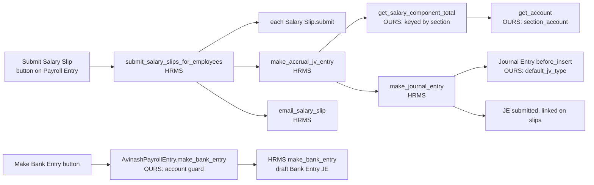

# 07 · After the slip: submit, journal, bank, reports, print

What happens once the draft slips are right ([06-salary-slip.md](06-salary-slip.md)): HR presses **Submit Salary Slip** on the Payroll Entry, HRMS submits the slips and writes one accrual Journal Entry, our Payroll Entry class splits the expense by section, our Journal Entry hook gives the journal the JV Type and number this app's books require, and **Make Bank Entry** pays the net. Then the reports, the payslip print format and the email.

Accounts-side description for the user: [../user-guide/09-accounts-setup.md](../user-guide/09-accounts-setup.md). Reports for the user: [../user-guide/07-reports.md](../user-guide/07-reports.md). Every setting here is a row in [impact-matrix.md](impact-matrix.md); hooks in [hooks-inventory.md](hooks-inventory.md). DB values read from `avinas1` on 2026-10-12.

---

## 7.1 Submitting the slips

**What.** [`submit_salary_slips`](../../../hrms/hrms/payroll/doctype/payroll_entry/payroll_entry.py#L282) (the *Submit Salary Slip* button) collects the entry's draft slips; more than 30 are queued as a background job. [`submit_salary_slips_for_employees`](../../../hrms/hrms/payroll/doctype/payroll_entry/payroll_entry.py#L1529) then, with `frappe.flags.via_payroll_entry` set:

1. submits each slip with `net_pay >= 0` (a negative one, or one that raises a ValidationError, is left as draft and listed);
2. if at least one was submitted, calls [`make_accrual_jv_entry`](../../../hrms/hrms/payroll/doctype/payroll_entry/payroll_entry.py#L1554) for the submitted ones, then emails them;
3. on **any** exception rolls back the whole batch (every slip submission included) and writes the error on the Payroll Entry.

**Stock HRMS vs ours.** All HRMS. Submitting a slip runs its `validate` again (all hooks of [06](06-salary-slip.md) §6.0, now with `docstatus` 1, so `add_employee_allowances` skips) and [`on_submit`](../../../hrms/hrms/payroll/doctype/salary_slip/salary_slip.py#L207) (net pay ≥ 0, status, loan repayment — no loan app installed). Before submitting the entry, HRMS [`validate_payroll_payable_account`](../../../hrms/hrms/payroll/doctype/payroll_entry/payroll_entry.py#L99) refuses a payable account that has an Account Type.

**Why the rollback matters here.** The accrual journal is written in the same transaction as the slip submissions. A journal that fails (no account on a component, missing section, missing JV Type) un-submits all slips. That is exactly the failure `hr_journal.py` was written for: "a payroll run got as far as 87 submitted slips, failed on the journal, and rolled the whole month back" (module docstring).

**Config on avinas1.** Three Payroll Entries, all submitted with journals: NGI-PAYR-83/84-00001 (Shrawan, 4 slips), NGI-PAYR-83/84-00002 (Bhadra, 87 slips), NGN-PAYR-83/84-00001 (Bhadra, 63 slips). `validate_attendance` = 0 on all three.

---

## 7.2 The accrual Journal Entry

**What.** One submitted Journal Entry per run, voucher type *Journal Entry*, posting date = the entry's posting date (the BS month's last day):

| Side | Lines | Built by |
|---|---|---|
| Debit | Each earning, totalled per (account, cost centre) | [`get_salary_component_total`](../../avinashgroup_app/payroll/payroll_entry.py#L76) + [`get_account`](../../avinashgroup_app/payroll/payroll_entry.py#L133) (ours) |
| Credit | Each deduction per (account, cost centre): SSF → SSF Payable, Income Tax → TDS-Remuneration, Late Fine → back to salary expense | same |
| Credit | Advance recoveries whose Additional Salary references an Employee Advance → the advance account, party = employee, reference = the advance | HRMS [`get_advance_deduction`](../../../hrms/hrms/payroll/doctype/payroll_entry/payroll_entry.py#L404) |
| Credit | Net pay → payroll payable account, referencing the Payroll Entry | HRMS [`set_payable_amount_against_payroll_payable_account`](../../../hrms/hrms/payroll/doctype/payroll_entry/payroll_entry.py#L694) |

Then [`make_journal_entry`](../../../hrms/hrms/payroll/doctype/payroll_entry/payroll_entry.py#L607) saves and submits it and writes its name into each slip's `journal_entry` ([`set_journal_entry_in_salary_slips`](../../../hrms/hrms/payroll/doctype/payroll_entry/payroll_entry.py#L1095)).

**Reads.** Submitted slips' Salary Detail rows (`amount`, not `default_amount`), Salary Component Account rows, Employee → Department → `custom_payroll_section`, payroll cost centres. **Writes.** Journal Entry, GL Entries, Salary Slip `journal_entry`.

### 7.2.1 Section accounts (O/O · S/D · F/P) — our override

**What.** `AvinashPayrollEntry` (registered in `override_doctype_class` as [`AvinashPayrollEntry`](../../avinashgroup_app/hooks.py#L509)) replaces two HRMS methods:

| Method | HRMS behaviour | Ours |
|---|---|---|
| [`get_salary_component_total`](../../avinashgroup_app/payroll/payroll_entry.py#L76) | HRMS's loop ([`get_salary_component_total`](../../../hrms/hrms/payroll/doctype/payroll_entry/payroll_entry.py#L355)) keyed by (component, cost centre) | Same loop keyed by (component, cost centre, **section**); throws "Set Payroll Section on the Department of these employees…" listing every employee whose component posts by section but whose department has none |
| [`section_for`](../../avinashgroup_app/payroll/payroll_entry.py#L124) | — | Section only when the component has an S/D or F/P account for the company ([`has_section_accounts`](../../avinashgroup_app/payroll/allowance.py#L138)); the section is [`get_section`](../../avinashgroup_app/payroll/allowance.py#L161) = Employee → Department → `custom_payroll_section` |
| [`get_account`](../../avinashgroup_app/payroll/payroll_entry.py#L133) | One account per component and company ([`get_salary_component_account`](../../../hrms/hrms/payroll/doctype/payroll_entry/payroll_entry.py#L308)) | [`section_account`](../../avinashgroup_app/payroll/allowance.py#L129): the column for the section on the company's Accounts row ([`SECTION_ACCOUNT_FIELD`](../../avinashgroup_app/payroll/allowance.py#L93): Admin & Accounts → `account`, Marketing → `custom_account_marketing`, Plant → `custom_account_plant`); blank S/D or F/P falls back to the row's own (O/O) account; no row → HRMS's account lookup, which throws |

**Why.** The chart keeps staff cost three ways and the client's sheet charges each person by department; HRMS posted it all to one account, so everything landed on O/O (module docstring of [`AvinashPayrollEntry`](../../avinashgroup_app/payroll/payroll_entry.py#L41); [../user-guide/09-accounts-setup.md](../user-guide/09-accounts-setup.md) §9.1). This replaced an earlier "Salary-Expenses-only" routing in `hr_journal.py`.

**Boundary.** Advance recoveries and the payable side remain HRMS's own code; only expense and deduction lines are re-keyed. Cost-centre splitting is HRMS's [`get_payroll_cost_centers_for_employee`](../../../hrms/hrms/payroll/doctype/payroll_entry/payroll_entry.py#L474) (assignment's Employee Cost Center rows → Employee `payroll_cost_center` → Department `payroll_cost_center` → the entry's cost centre).

**Config on avinas1.**

| Item | Value |
|---|---|
| Cost centres | No Employee Cost Center rows, no Employee or Department `payroll_cost_center`: **every payroll line posts to `Main - <abbr>`**. The section is expressed by the account, not the cost centre |
| NGI Accounts rows | 23 components. Every earning and the Late Fine: `547101 - Salary Expenses - O/O`, `547102 - … S/D`, `547103 - … F/P`. SSF → `347302 - SSF Payable`, Income Tax → `348102 - 11112 TDS-Remuneration Income Tax`, Salary Advance → `148003 - Staff Advance` (no section columns) |
| NGN Accounts rows | 11 rows. **Tea & Conveyance and Meal have no account (and Meal has two rows)**; **Education Allowance's S/D column holds the O/O account 547101**. Several components have no row |
| NGG / NGK / GLMI / GEPL / SGU | NGG 1 row (Meal, no account); the rest none. A run there would fail at the journal |
| Department sections | Every department has a section except one. **80 active employees have no Department** (NGG 49, NGK 13, NGN 8, NGI 10), so a run that includes them fails with the missing-section message |

Actual journal, NGI Bhadra (NGI-JE-83/84-00005, 2026-09-16): Dr F/P 16,44,441.81 · Dr O/O 10,33,941.20 · Dr S/D 4,44,416.02 · Cr TDS-Remuneration 5,730.00 · Cr SSF Payable 4,51,003.44 · Cr Salary Payable 26,66,065.59 (= Σ net pay of 87 slips). NGI Shrawan (NGI-JE-83/84-00004) also shows the late fines credited back to their sections' expense: O/O 84.06, F/P 55.11.

**Impacts downstream.** The P&L by section; the Avinas Salary Statement's journal check (7.5); a missing account or section blocks the whole submission (7.1).

**Gotchas.**
- A late fine is a **credit to salary expense**, not income: there is no fines-income account ([../payroll-ngi.md](../payroll-ngi.md) "Posting to the books").
- The journal posts each Salary Detail `amount`, and HRMS derives the payable credit from those same rows, so the journal always balances. Stale allowance rows on a re-saved draft (Gotcha G1 in [06](06-salary-slip.md) §6.5) could once have made the rows differ from `net_pay`; fixed 2026-10-12.
- [../payroll-ngi.md](../payroll-ngi.md) "Posting to the books — needs the accountant" still says no component is mapped and a component maps to one account; both are out of date for NGI.
- `sibling_account` ([`sibling_account`](../../avinashgroup_app/payroll/allowance.py#L143)) proposes the S/D and F/P twin of an O/O account by name; it is a set-up helper, not used at posting time. Account rows are filled by [`map_component_accounts`](../../avinashgroup_app/payroll/onboarding.py#L663).

### 7.2.2 JV Type and Document No (`default_jv_type`)

**What.** Before a Journal Entry is inserted, if any row references a Payroll Entry or Employee Advance ([`HR_REFERENCES`](../../avinashgroup_app/payroll/hr_journal.py#L28)): sets `custom_p_type` (JV Type) to the voucher type when such a JV Type exists (else *Journal Entry*); for a hand-numbered series, draws the next `custom_document_no` with the numbering engine's [`_docno_scope`](../../avinashgroup_app/custom_code/Override/naming_series.py#L952) / [`_draw_next_document_no`](../../avinashgroup_app/custom_code/Override/naming_series.py#L1163) and ticks `custom_document_no_manual`; an auto-numbered series (Bank Entry) is left to number itself.

**Where.** [`default_jv_type`](../../avinashgroup_app/payroll/hr_journal.py#L30), registered **first** in Journal Entry `before_insert` ([`default_jv_type`](../../avinashgroup_app/hooks.py#L320)), ahead of the naming hooks that read the JV Type.

**Why.** Every Journal Entry here requires a JV Type and Document No; HRMS writes two journals with nobody at the form (payroll accrual, Employee Advance payout) and they failed, rolling back 87 submitted slips (module docstring). Anything an accountant typed is left alone.

**Config on avinas1.** JV Types `Journal Entry`, `Bank Entry`, `Cash Entry` exist. Result on the three accruals: `custom_p_type` = Journal Entry, Document No 1 / 2 (NGI) and 1 (NGN), voucher numbers `NGI-JV-000001-83/84`, `NGI-JV-000002-83/84`, `NGN-JV-000001-83/84`. Numbering and fiscal-year rules are in [09-cross-cutting.md](09-cross-cutting.md).

**Gotcha.** The drawn number is the next in the company + JV Type + fiscal-year series at insert time; if the payroll transaction later rolls back, nothing is consumed, but a concurrent manual journal could take the same number first (guarded by the duplicate check because the field is marked manual).

### 7.2.3 The payroll payable account

**What.** `Company.default_payroll_payable_account` fills the entry's `payroll_payable_account`; HRMS refuses it if it has any Account Type ([`validate_payroll_payable_account`](../../../hrms/hrms/payroll/doctype/payroll_entry/payroll_entry.py#L99)).
**Patch.** `clear_payroll_payable_account_type` ([`execute`](../../avinashgroup_app/patches/clear_payroll_payable_account_type.py#L13)) blanked the type on each company's default payable account (the chart came with "Payable" at NGN, "Liability" at NGG/NGK).
**Config on avinas1.** NGI, NGN, NGG, NGK → `347301 - Salary Payable - <abbr>`, type blank. GLMI, GEPL, SGU: no default; their `347301` accounts are still typed `Liability`, so the first payroll there needs the same fix.
**Gotcha.** An assignment whose own *Payroll Payable Account* differs from the entry's is silently left out of the entry ([../user-guide/09-accounts-setup.md](../user-guide/09-accounts-setup.md) §9.5).

---

## 7.3 Paying the net: Make Bank Entry

**What.** [`AvinashPayrollEntry.make_bank_entry`](../../avinashgroup_app/payroll/payroll_entry.py#L55) refuses when the **saved** Payment Account is empty or not of type Bank or Cash ([`PAYMENT_ACCOUNT_TYPES`](../../avinashgroup_app/payroll/payroll_entry.py#L38)), then calls HRMS's [`make_bank_entry`](../../../hrms/hrms/payroll/doctype/payroll_entry/payroll_entry.py#L876), which totals the submitted slips' earnings minus deductions and builds a **draft** Journal Entry, voucher type *Bank Entry* ([`set_accounting_entries_for_bank_entry`](../../../hrms/hrms/payroll/doctype/payroll_entry/payroll_entry.py#L1007)): Cr the payment account, Dr the payroll payable account referencing the Payroll Entry. The accountant reviews and submits it; `default_jv_type` gives it JV Type *Bank Entry* and leaves its number to the auto series.

**Why our guard.** Payment Account is *Allow on Submit*; picked but not saved with *Update*, the server saw none and ERPNext crashed with a TypeError (NGI-PAYR-83/84-00002, 2026-10-09). Nothing stopped a non-bank account either (docstring).

**Config on avinas1.** NGI-PAYR-83/84-00002 has `payment_account` = **`141101 - Gas Purchase / Stock - NGI`** — the exact wrong account the guard was written for; the button now refuses it. The other two entries have none. **No Bank Entry referencing a Payroll Entry exists yet** (0 rows), so Salary Payable still carries the full net pay of all three runs.

**Gotcha.** The bank entry pays the sum of slip amounts (paisa included), not each slip's `rounded_total`. Salary paid by a hand-made Payment Entry or Journal instead of this button is not linked to the Payroll Entry, and HRMS's "bank entry already made" check will not see it.

---

## 7.4 Emailing the payslips

**What.** After the journal, [`email_salary_slip`](../../../hrms/hrms/payroll/doctype/payroll_entry/payroll_entry.py#L303) on the entry calls each slip's [`email_salary_slip`](../../../hrms/hrms/payroll/doctype/salary_slip/salary_slip.py#L1922): subject and body rendered from Payroll Settings' email template, the slip attached as a PDF in its **default print format**, sent to the Employee's `prefered_email` only.

**Config on avinas1.** `email_salary_slip_to_employee` = 1, `email_template` = `Salary Slip (BS)` (subject `Salary Slip — {{ custom_bs_month }} · {{ company }}`), `encrypt_salary_slips_in_emails` = 0, sender blank (default outgoing account). Template and setting were created by [`set_payslip_defaults`](../../avinashgroup_app/patches/setup_hr_bs_dates.py#L97). **The Email Queue holds no Salary Slip mail, and none of NGI's 100 active employees has any email address** — so nothing has been sent; HRMS shows "Employee email not found" for each.

**Gotcha.** HRMS reads `prefered_email` only (filled from *Prefered Contact Email*); a company or personal email alone is not enough. [../user-guide/06-salary-slip.md](../user-guide/06-salary-slip.md) §6.4 says "the employee's email on their Employee record", which is looser than the code.

---

## 7.5 Reports

| Report | Type / ref doctype | Roles | What it shows | Code |
|---|---|---|---|---|
| **Avinas Salary Statement** | Script, Salary Slip | HR Manager, HR User, System Manager | The client's salary sheet from the slips: one row per person grouped O/O · S/D · F/P with subtotals, Basic split into full / deduction / net, allowance columns, OT hours, meal qty, late hours (from Additional Salary `custom_quantity`), SSF, tax, advances, net payable; plus a **journal check** | [`execute`](../../avinashgroup_app/avinash_group_app/report/avinas_salary_statement/avinas_salary_statement.py#L65), [`journal_check`](../../avinashgroup_app/avinash_group_app/report/avinas_salary_statement/avinas_salary_statement.py#L390), [`section_of_accounts`](../../avinashgroup_app/avinash_group_app/report/avinas_salary_statement/avinas_salary_statement.py#L470) |
| **Salary Tax and SSF Deposit** | Script, Salary Slip | HR Manager, HR User, System Manager | Per employee and in total: SSF employer 20%, employee 11%, deposit 31%, CIT, **SST (1%)**, remuneration tax, total withheld; due dates | [`execute`](../../avinashgroup_app/avinash_group_app/report/salary_tax_and_ssf_deposit/salary_tax_and_ssf_deposit.py#L50), [`_sst_share_calculator`](../../avinashgroup_app/avinash_group_app/report/salary_tax_and_ssf_deposit/salary_tax_and_ssf_deposit.py#L141) |
| Advance Tax TDS Details | Script, Purchase Invoice | Accounts Manager, Accounts User | Supplier TDS, plus partyless TDS journal lines — which **includes the payroll accrual's TDS-Remuneration credit** (an account named "TDS") | [`_get_partyless_je_rows`](../../avinashgroup_app/avinash_group_app/report/advance_tax_tds_details/advance_tax_tds_details.py#L127), [`_tds_accounts`](../../avinashgroup_app/avinash_group_app/report/advance_tax_tds_details/advance_tax_tds_details.py#L87) |
| HRMS Salary Register | Script (HRMS), Salary Slip | HRMS defaults | Stock per-slip component grid | [`execute`](../../../hrms/hrms/payroll/report/salary_register/salary_register.py#L16) |
| HRMS Income Tax Computation, Bank Remittance, Salary Payments Based On Payment Mode | HRMS | HRMS defaults | Stock reports; not adapted to BS months | [`execute`](../../../hrms/hrms/payroll/report/income_tax_computation/income_tax_computation.py#L13) |
| HR dashboard payroll / statutory cards | Page (HR workspace) | Salary Slip read | Month's payroll totals, month-close state, statutory deposits due | [`_payroll`](../../avinashgroup_app/hr/hr_dashboard.py#L260), [`_statutory`](../../avinashgroup_app/hr/hr_dashboard.py#L384), [`STATUTORY_DEPOSITS`](../../avinashgroup_app/hr/hr_dashboard.py#L52) |

`Loan Summary` (GL Entry, accounts) is about bank loans, not staff advances; it does not read payroll.

### Avinas Salary Statement — details

**Why.** Each company ran payroll on its own Excel (the Falgun 2082 sheets); this prints the same sheet from the slips so the two can be laid side by side (docstring, [../allowances.md](../allowances.md) "The salary sheet"). It **reproduces, never recomputes**: every amount is the slip's own; a component the layout does not name still gets a column so columns add up to the totals. Section labels come from [`SECTION_LABELS`](../../avinashgroup_app/avinash_group_app/report/avinas_salary_statement/avinas_salary_statement.py#L37); quantity columns from [`QUANTITIES`](../../avinashgroup_app/avinash_group_app/report/avinas_salary_statement/avinas_salary_statement.py#L62). The month is chosen as on the Payroll Entry (Fiscal Year + BS Month).

**Journal check.** For submitted slips, compares each section's gross against the accrual journal's expense **debits** to that section's accounts, and net pay against the credit to the payable account; green *Matches Journal* or red cards naming the difference. It also flags an account set under two sections (`section_of_accounts` returns clashes): the NGN Education Allowance S/D-holds-O/O mistake is exactly what it reports ([../user-guide/09-accounts-setup.md](../user-guide/09-accounts-setup.md) §9.7: 11,250 of S/D cost booked to O/O in NGN Bhadra).

**Gotchas.** The `DEDUCTIONS` layout names a *Dashain Advance* component that does not exist on avinas1 (column always 0). The report reads `tabSalary Slip` through the read replica like every report ([09-cross-cutting.md](09-cross-cutting.md)).

### Salary Tax and SSF Deposit — the SST split

**Why.** Accounts deposits three amounts on separate vouchers: SSF (31%) to the Social Security Fund by the 15th of the next BS month, SST (1% band, staff outside SSF only) and remuneration tax to IRD by the 25th. The slip has one Income Tax row, so the report splits it (docstring).

**How.** For a non-SSF slip: `SST = month's tax × (first-band tax ÷ total annual tax)`, both from the slip's `annual_taxable_amount` and the company's slab (found by [`tax_slab_for`](../../avinashgroup_app/payroll/year_rollover.py#L35)); SSF members get SST 0. Over a year the shares add to the SST actually charged. SSF employee share = SSF − SSF Addition. Slips are those whose period **ends** in the chosen BS month. Deadlines come from `STATUTORY_DEPOSITS`, "pending the accountant's confirmation".

**Gotchas.**
- `custom_ssf_applicable` is read from [`current_assignment`](../../avinashgroup_app/payroll/allowance.py#L221) at the slip's end date, not from the slip; a later assignment change alters an old month's split.
- The SST share uses the slip's `annual_taxable_amount`, which `apply_tax_reliefs` raises by the retirement excess but `apply_income_tax_override` does not touch; on an overridden slip the split is proportional to an annual figure the override ignored.
- [`CIT_COMPONENT`](../../avinashgroup_app/avinash_group_app/report/salary_tax_and_ssf_deposit/salary_tax_and_ssf_deposit.py#L47) = `CIT`, a component that does not exist on avinas1: the CIT column is always 0.
- Nothing is posted: the deposit vouchers are made by hand. The accrual journal's credits to `347302 SSF Payable` and `348102 TDS-Remuneration` are what those vouchers clear.

---

## 7.6 The payslip print format

| Item | Value |
|---|---|
| Print Format | **Salary Slip BS** (standard, module Avinash Group App) — its [`html`](../../avinashgroup_app/avinash_group_app/print_format/salary_slip_bs/salary_slip_bs.json#L11) only includes the Jinja template |
| Template | `templates/print_formats/salary_slip_bs.html` (159 lines; [`Salary Slip BS`](../../avinashgroup_app/templates/print_formats/salary_slip_bs.html#L2) header comment) |
| Default for Salary Slip | Property Setter `default_print_format` = `Salary Slip BS`, made by [`set_payslip_defaults`](../../avinashgroup_app/patches/setup_hr_bs_dates.py#L97). This is also what HRMS attaches to the email |
| Other formats on the site | HRMS's *Salary Slip Standard*, *with Year to Date*, *based on Timesheet* (enabled, not default) |

**What it prints.** Company, `custom_bs_month`, BS and AD period; employee, designation, department, PAN (`custom_pan` or `pan_number`), SSF No. (`custom_ssf_id_no`), joining miti, bank; total working days, payment days, LWP, absent days, posting miti; earnings and deductions side by side (statistical components hidden); gross, total deduction, **net pay = `rounded_total`** (falls back to `net_pay`), amount in words; a note when the tax was overridden, a retirement excess was taxed or the women's rebate applied ([`custom_override_income_tax`](../../avinashgroup_app/templates/print_formats/salary_slip_bs.html#L113)); then page 2, the Daily Breakdown ([`custom_daily_breakdown`](../../avinashgroup_app/templates/print_formats/salary_slip_bs.html#L126)).

**Why.** The HRMS format shows AD dates and no breakdown; staff read BS ([06](06-salary-slip.md) §6.12, `patches/setup_hr_bs_dates.py` docstring).

**Gotcha.** The template calls [`frappe.get_doc`](../../avinashgroup_app/templates/print_formats/salary_slip_bs.html#L8) on the Employee at print time, so PAN, SSF No. and bank print **today's** Employee values on an old slip.

---

## 7.7 Cancelling after submit (summary)

Cancelling the Payroll Entry ([`on_cancel`](../../../hrms/hrms/payroll/doctype/payroll_entry/payroll_entry.py#L107)) cancels **and deletes** its slips and cancels its journals ([`cancel_linked_journal_entries`](../../../hrms/hrms/payroll/doctype/payroll_entry/payroll_entry.py#L144)); more than 50 slips are queued. The Additional Salary posted by Prepare Payroll Inputs stays submitted and is reused by a new entry for the same month. Amending a single slip, arrears and the rest of "changing a paid month" are in [08-changes-over-time.md](08-changes-over-time.md).

---

## 7.8 Known open issues (this stage)

| # | Issue | Status |
|---|---|---|
| A1 | NGI-PAYR-83/84-00002's Payment Account is the gas stock account; no bank entry made for any run, so Salary Payable holds all three months' net pay | Accountant to set the bank account, press Update, then Make Bank Entry |
| A2 | 80 active employees without a Department → missing section → journal refused when they are paid | HR data |
| A3 | NGN: Tea/Meal without account, duplicate Meal row, Education S/D = O/O account; NGG/NGK/GLMI/GEPL/SGU have no component accounts | Accountant ([../user-guide/09-accounts-setup.md](../user-guide/09-accounts-setup.md) §9.4) |
| A4 | Nobody has a preferred email, so slip emails go nowhere | HR data |
| A5 | GLMI/GEPL/SGU payable accounts are typed `Liability` and are not the company default | Fix before their first payroll |
| A6 | Staff Advance `148003` is typed Payable at NGN/NGG/NGK/GLMI; HRMS requires Receivable for Employee Advance | Accountant ([08](08-changes-over-time.md)) |
| A7 | No payroll cost centres anywhere: all lines on `Main - <abbr>` | By design for now; sections ride on accounts |
