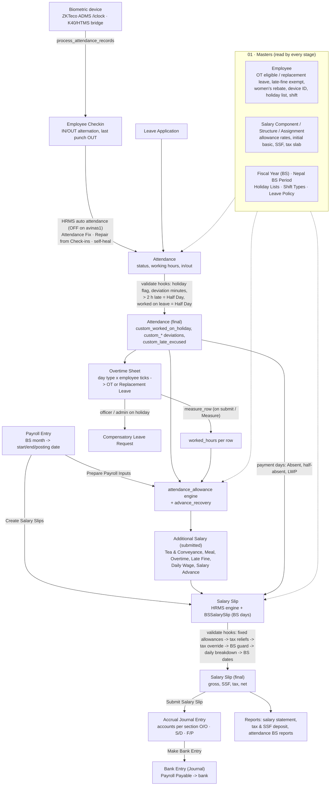

# HR and payroll system reference

How the Avinash Group's HR and payroll works: from a biometric punch to a salary slip, the payroll journal and the bank payment. Every stage has its own page. Each page covers what the code does, **why** it exists (the business rule or client decision), **where** it is (file:line links), what triggers it, what it reads and writes, and what changes downstream if you touch it.

This is written for a developer or for the owner, so that any rupee on a slip can be traced back to the punch and to the setting that produced it. For HR staff's day-to-day steps, read the [user guide](../user-guide/README.md). For a function-by-function list in run order, read the [salary code map](../salary-code-map.md) and its CodeTour `.tours/salary-calculation.tour`.

Facts about configuration come from the working site **avinas1**, read on 2026-10-12. Code links point at `develop`, hrms 15.49.2 and rdp_common_app `develop` on the same date.

## Who owns what

| App | Owns in this pipeline | Edited here? |
|---|---|---|
| `avinashgroup_app` (this repo) | Device intake (ADMS, bridge), attendance rules (late half day, holiday flag, deviation fields), Attendance Fix and self-heal, Overtime Sheet, BS payroll month, **Prepare Payroll Inputs** (tea, meals, OT, late fine, advances as Additional Salary), fixed allowances, tax reliefs and override, daily breakdown, section accounts on the journal, Salary Revision, year rollover, reports | yes |
| `hrms` 15.49.2 | Employee Checkin, auto attendance, Attendance, Leave, Shift Type/Assignment, Payroll Entry, the Salary Slip engine (structure formulas, payment days, slab tax), Additional Salary, accrual JV and bank entry | never |
| `rdp_common_app` | `BSSalarySlip` (Salary Slip class: BS months), Nepal HRMS Settings, Nepal BS Period | not from here |
| `erpnext` / `frappe` | Company, Fiscal Year, accounts, Journal Entry, workflow, scheduler | never |

`nepal_hrms` is present under `apps/` but **not installed** on avinas1. Its Nepal HRMS Settings doctype is not the one in use; avinas1 uses the copy in `rdp_common_app/nepal_hrms_common`.

## The pipeline



## Pages

| # | Page | Covers |
|---|---|---|
| 01 | [Masters: people, time, calendar](01-masters.md) | Employee custom fields (incl. Overtime Eligible / Replacement Leave), Department section, Holiday Lists, Shift Types / Assignment / rotation, Leave Types and BS earned leave, Fiscal Year (BS), BS calendar, yearly setup, onboarding |
| 01b | [Masters: pay](01b-pay-masters.md) | Payroll Settings, Nepal HRMS Settings, Payroll Period, Income Tax Slab, exemption categories, Salary Components and their rule fields, Salary Structures with Allowance Rates, Salary Structure Assignment (Allowances, Initial Basic, SSF), accounts; **appendix: every HR/payroll patch** |
| 02 | [Check-in → Attendance](02-checkin-to-attendance.md) | Devices, ADMS and bridge intake, Employee Checkin, IN/OUT alternation, HRMS auto attendance (and that it is off), self-heal, Attendance Fix, Attendance validate hooks, leaves, holidays, unmarked = Present, backdated shifts |
| 03 | [Shift measurement](03-shift-measurement.md) | `measure_day`, late / early minutes, Late Excused, half-day and holiday treatment, the BS attendance reports |
| 04 | [Overtime](04-overtime.md) | Overtime Sheet rules, measurement, replacement leave, how hours reach payroll |
| 05 | [Payroll Entry and payroll inputs](05-payroll-entry.md) | BS month, our Payroll Entry class, Prepare Payroll Inputs (attendance engine), advance recovery, guards, slip creation |
| 06 | [Salary Slip](06-salary-slip.md) | HRMS engine, BS class, payment days, hook order, fixed allowances, SSF, tax (slab, retirement cap, women's rebate, manual override), daily breakdown, net pay |
| 07 | [After the slip](07-after-the-slip.md) | Submit, accrual journal, section accounts, JV Type, bank entry, reports, payslip print formats |
| 08 | [Changes over time](08-changes-over-time.md) | Salary Revision (raise / add / stop / change rate, arrears), year rollover, hand-made Additional Salary, festival allowance, advances, cancel and amend |
| 09 | [Cross-cutting](09-cross-cutting.md) | Dynamic Approval, numbering and fiscal-year blockers, fiscal-year list filter, read replica, scheduler, permissions, audit, HR dashboard, tests |
| — | [Impact matrix](impact-matrix.md) | **"If I change X, what moves?"** Every custom field and setting, with where it is written, where it is read, and what it affects |
| — | [Hooks inventory](hooks-inventory.md) | Every HR/payroll doc_event, class override, scheduler job, JS hook and whitelisted endpoint, with its handler and purpose, and the order Frappe runs them in |

## Tracing a rupee: the short version

| Line on the slip | Comes from | Page |
|---|---|---|
| Basic (and other structure earnings) | Salary Structure row formula × assignment `base`, prorated by payment days ÷ BS month days | [06](06-salary-slip.md), [01b](01b-pay-masters.md) |
| Fixed allowance (Monthly / % of Initial Basic) | Assignment's Allowances table (`Assignment Allowance`), added by `add_employee_allowances` | [06](06-salary-slip.md) |
| Tea & Conveyance, Meal, Overtime, Late Fine, Daily Wage | Additional Salary written by **Prepare Payroll Inputs**, from Attendance (and Overtime Sheet hours) × the person's rate or hourly basic | [05](05-payroll-entry.md), [03](03-shift-measurement.md), [04](04-overtime.md) |
| Salary Advance | Additional Salary from the open Employee Advance's monthly instalment | [05](05-payroll-entry.md) |
| Arrears | Additional Salary `Salary Arrears` from a Salary Revision | [08](08-changes-over-time.md) |
| SSF | Structure deduction / employer rows on the SSF-applicable base | [06](06-salary-slip.md), [01b](01b-pay-masters.md) |
| Income tax | HRMS slab tax on the year's projected taxable pay, less exemptions; then our retirement cap and women's rebate; then any hand override | [06](06-salary-slip.md) |
| Payment days | BS month length less Absent, half-absent and LWP days (unmarked days count as Present) | [06](06-salary-slip.md), [02](02-checkin-to-attendance.md) |
| Which account it posts to | Salary Component Account row (O/O), or the S/D or F/P account for the employee department's section | [07](07-after-the-slip.md) |

## Things to know before changing anything

These facts change how the rest of this reference reads. Each is explained on the linked page.

- **The scheduler is off on avinas1** (`enable_scheduler = 0`). Self-heal, BS earned-leave accrual, `measure_pending`, `grant_pending`, the holiday-year switch and the 13:10 digest never run here. They have run in production only if the scheduler is enabled there (unverified from this box). See [hooks-inventory.md §4](hooks-inventory.md).
- **HRMS auto attendance is off on both avinas1 shift types.** Attendance comes from Attendance Fix, from the "Repair from Check-ins" button, or from hand entry. Self-heal also skips shifts with auto attendance off. See [02](02-checkin-to-attendance.md).
- **Install order is `avinashgroup_app` → `rdp_common_app` → `hrms`.** Our doc_events run before HRMS's on the same doctype. The Salary Slip class belongs to `rdp_common_app`, which is why every slip change of ours is a `validate` hook. See [hooks-inventory.md](hooks-inventory.md).
- **`read_from_replica` is 0 on avinas1**, not 1 as the project CLAUDE.md says. The replica has been stuck since 2026-09-29 (hr-handoff 2026-10-08), and the runbook `docs/db-master-slave-replication.md` was deleted. Reports read the master today. See [09](09-cross-cutting.md).
- **avinas1 holds test-scale HR data, not a live operation.** There are 0 biometric devices, 0 checkins, 0 Shift Assignments and 0 Leave Policies or Leave Periods. There are 105 seeded Attendance rows (4 NGI employees, Shrawan 2083) and 10 Additional Salary rows. There are three payroll runs (NGI Shrawan; NGI and NGN Bhadra) and no bank entries. 70 active employees have no Salary Structure Assignment, and 261 of 265 have neither Overtime Eligible nor Replacement Leave ticked. Counts are on each stage page.
- **No HR fixtures.** Every HR custom field and setting was created by a patch in `patches.txt`. A new site gets them only through `migrate`. See the patch appendix in [01b](01b-pay-masters.md#appendix-hr--payroll-patches-in-patchestxt-order).

## Checking the links

Every `file#Lnnn` link in these pages was checked by a script. The script confirms that the target line contains the backticked symbol named in the link text. After editing code these pages point at, re-run a checker of the same kind, for example:

```bash
python3 path/to/check_links.py docs/system-reference
```

The check is simple: for each link whose text is a backticked symbol and whose target ends in `#L<n>`, it opens the file and confirms that line *n* contains the symbol. Unlike `docs/salary-code-map.md`, these pages are not generated from a template, so a moved function means editing the line number here by hand.
