# 14. Monthly Attendance BS: the illustrated guide

[Back to contents](README.md)

Monthly Attendance BS is where HR checks a month's attendance and fixes it before payroll. Almost every attendance correction can be made from this one screen. This chapter shows each part of the screen, what each button changes behind the scenes, how to undo it, and which setting to change when a rule itself is wrong.

The pictures are real data from Nepal Gas Udhyog Pvt. Ltd. (NGI), Shrawan and Bhadra 2083, taken on 16 November 2026 while logged in as an HR Manager. The rules are explained in full in [Chapter 3](03-attendance-leave-holidays.md) and [Chapter 7](07-reports.md#72-monthly-attendance-bs--the-attendance-sheet); this chapter is the visual tour.

**Who sees what.** Everybody who can open the report sees the grid and the **Correction Log** button. The other buttons and the clickable cells (✎) are only for **HR Manager** and **System Manager**.

---

## 14.1 The screen at a glance

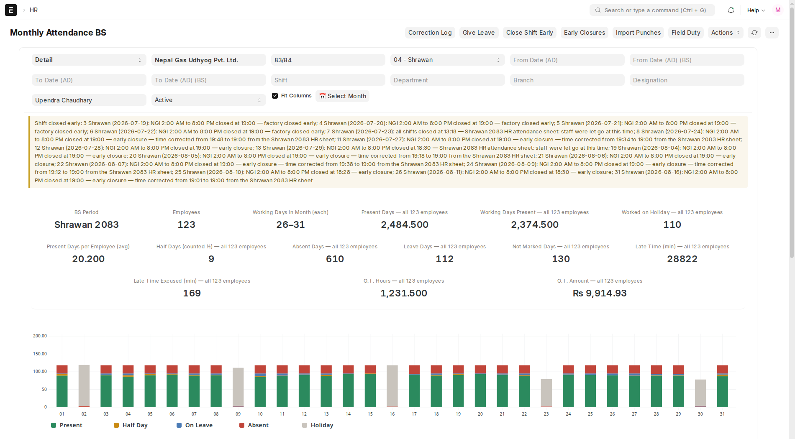

From top to bottom:

1. **Buttons** (top right): Correction Log · Give Leave · Close Shift Early · Early Closures · Import Punches · Field Duty. Each is explained below.
2. **Filters.** **View** (Detail = one row per person per day; Summary = one row per person). **Company**, **Fiscal Year** (83/84) and **BS Month** pick the month. **From / To Date (AD)** only for a custom range; a BS Month, if set, wins. Shift, Department, Branch, Designation and Employee narrow it down. **Status** is the employee status (Active by default).
3. **The yellow strip** lists every early closure in the period ("3 Shrawan … closed at 19:00 — factory closed early"). If there is none, the strip is not shown.
4. **Cards**: the month in numbers. With one employee chosen, they are that person's month. With many, they are sums ("Present Days — all 123 employees"). Late Time is late arrival + early leaving, in minutes. Late Time Excused is shown beside it.
5. **Chart**: statuses per day of the month.
6. **The grid** (below the chart).

### What to fix, and where

| What you see | What to use | Section |
|---|---|---|
| A punch is missing (red **— —**) or a time is wrong | Click **First IN** / **Last OUT** | [14.3](#143-correct-a-punch-or-a-shift) |
| The person was on another shift that day | Click **Shift** | [14.3](#143-correct-a-punch-or-a-shift) |
| Late for a real reason (traffic jam, funeral) | Click **Excuse ✎** | [14.4](#144-excuse-late-time-for-one-day) |
| Absent, but it was really leave (phoned in sick, went home) | **Give Leave** | [14.5](#145-give-leave-including-half-day-leave) |
| Left at the break on a half-day leave and is fined for it | Nothing: the half-day rule already handles it | [14.5](#the-half-day-leave-rule) |
| The whole factory let people go early | **Close Shift Early** | [14.6](#146-the-company-closed-early) |
| Out on official work (bank, customs, site visit) | **Field Duty** | [14.7](#147-staff-out-on-official-work-field-duty) |
| Staff who sign a register instead of punching | **Import Punches** | [14.8](#148-staff-with-no-device-import-punches) |
| "Who changed this, and why?" | **Correction Log**, or hover the amber cell | [14.9](#149-who-changed-what-the-correction-log) |
| Worked late but no overtime shows | Make an **Overtime Sheet** (not on this screen) | [Chapter 4](04-overtime-and-meals.md) |

---

## 14.2 Reading the grid

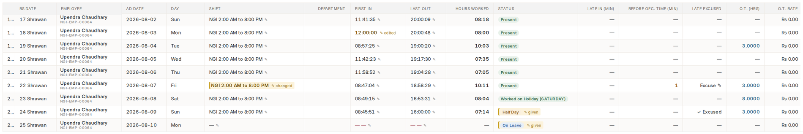

The picture is one employee, Upendra Chaudhary, filtered with **Employee**. Every marker in it means something:

| Marker | Meaning | Hover it to see |
|---|---|---|
| **12:00:00 ✎ edited** (amber), 18 Shrawan | HR typed or moved this punch; the device read something else (here the IN was missing) | What the device read, who changed it, when, why |
| **NGI 2:00 AM to 8:00 PM ✎ changed** (amber), 22 Shrawan | HR put this day on another shift | The old shift, who, when, why |
| **Half Day ✎ given** / **On Leave ✎ given** (amber), 24–25 Shrawan | Leave given by HR from this report, not applied for | Who gave it, when, why |
| **✓ Excused** (green), 24 Shrawan | Late time excused for this day: shown, but not fined | The reason |
| **Excuse ✎** (grey), 22 Shrawan | This day has late minutes and can be excused | |
| **— —** (red) under First IN / Last OUT | No punch recorded. Click to add it | |
| Plain time with a small ✎ | A device punch. Click to correct it | |
| A **red** remark "Marked from … not the first and last punch" | The attendance was marked from other times than its punches. Click First IN and save without changing anything to re-mark the day | |

The colours in **Late In (min)** and **Before ofc. Time (min)**: up to 15 minutes is brown, more is red. Both count in Late Time and in the late fine, from the first minute. **O.T. (hrs)** only shows on a day an approved Overtime Sheet covers.

Scroll the grid right for the rest of the columns:

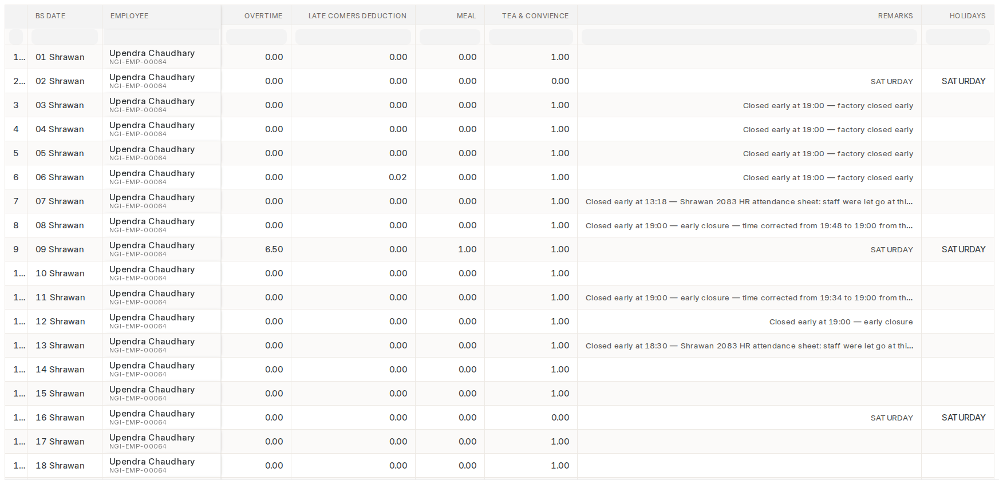

- **Overtime, Late Comers Deduction, Meal, Tea & Convience**: one column per attendance allowance, with the count payroll will use for that day. If a number here is wrong, the payslip will be wrong.
- **Remarks**: why the day looks the way it does: "Closed early at 19:00 — factory closed early", "SATURDAY", "LEAVE — HOME LEAVE", "Field duty 11:30-17:30 (Butwal: …)".
- **Holidays**: the holiday's name, from the person's own holiday list.

### The Summary view

Set **View = Summary** for one line per person for the month. This is the sheet to compare with HR's own monthly sheet.

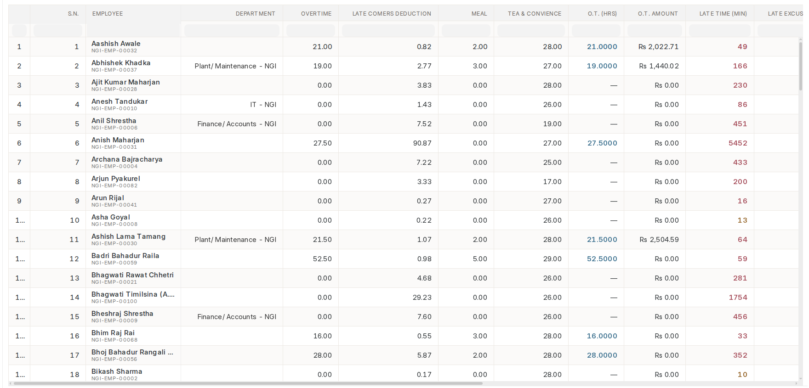

Columns: the allowance totals, **O.T. (hrs)** and **O.T. Amount**, **Late Time (min)**, **Late Excused (min)**, **Present Days**, **Working Days Present** (a half day for lateness counts ½; a half day with half-day leave counts 1, since the other half is paid leave), **Worked on Holiday**, and **Leave** for this month, the previous month and the year to date.

An employee with O.T. hours but **Rs 0.00** O.T. amount is ticked **Replacement Leave for Holiday Work**: they get a day of leave instead of money ([Chapter 4.7](04-overtime-and-meals.md#47-replacement-leave-for-officer--admin)).

---

## 14.3 Correct a punch or a shift

**When:** a punch is missing or wrong, or the person worked another shift that day.

1. In **Detail** view, click the day's **First IN**, **Last OUT** or **Shift** cell.
2. The **Correct Attendance** dialog opens with the day's current IN, OUT, shift and status.
3. Change the punch times, the shift, or both. To put several days on the new shift, set **Same Shift Until** (up to 31 days).
4. Type a **Reason** (required), for example "Forgot to punch out; confirmed by supervisor".
5. Click **Save Correction**.

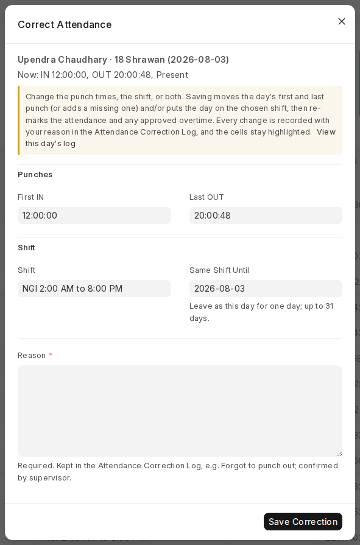

**What changes behind the scenes**

| Record | What happens |
|---|---|
| Employee Checkin | The first punch moves to the new IN and the last to the new OUT, or a missing one is added. It is marked as entered by hand, with the reason. |
| Shift Assignment (only if the shift changed) | The old assignment is cut around those days, and one new assignment covers exactly them. The days before and after keep their shift. |
| Attendance | Re-marked from the new punches: status, hours, late and early minutes. |
| Overtime Sheet | Any approved sheet for that day is re-measured. |
| Attendance Correction Log | One row: before → after, reason, who, when. |

**Refused:** today (it is still being marked), a day inside a submitted salary slip (cancel the slip first), times that would leave another punch of the day outside the new IN–OUT, another company's shift, overnight shifts. On a leave day the punches are saved and the leave is kept: the day becomes Half Day, other half Present (came in while on leave). The shift of a leave day can't be changed.

**Undo:** open the same cell again and put the old values back. The log keeps both changes.

---

## 14.4 Excuse late time for one day

**When:** the person was late or left early for a reason the company accepts.

1. Click **Excuse ✎** in the **Late Excused** column of that day.
2. Tick **Late Excused**, type the reason, and click **Save**.

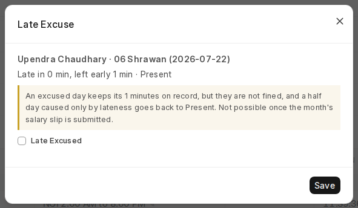

**What happens:** the same **Late Excused** tick is set on that day's Attendance. The minutes stay on record but are not fined. A Half Day caused only by lateness goes back to Present. The cards add the minutes to **Late Time Excused (min)**.

**Undo:** click **✓ Excused** and untick it. **Refused** once the month's salary slip is submitted ("Already Paid").

---

## 14.5 Give leave, including half-day leave

**When:** a day shows Absent (or Present with no punch) but was really leave nobody applied for, such as a phoned-in sick day or someone who went home at the break.

1. Click **Give Leave**.
2. Pick the **Employee** and **Leave Type**. Only types the person has an allocation for are listed, plus Leave Without Pay.
3. Set **From** and **To**, then untick any day in between that is not leave.
4. For half a day: tick **Half Day** **and** fill **Half Day Date**. Without the date, the whole day is taken.
5. Check the yellow box, which shows the **Balance**, what **this uses** and what is left **after**.
6. Type the **Reason** and click **Give Leave**.

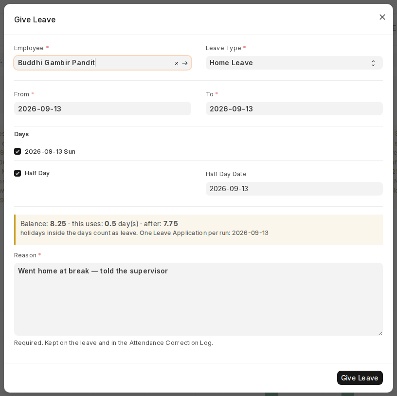

**What happens:** one approved **Leave Application** is filed for each run of consecutive days, with you as the approver. HRMS then marks the days On Leave (or Half Day), and the balance and leave ledger follow as for any approved leave. Each day is logged as **Leave Given**, and in the grid the status shows **✎ given**. A day the person punched becomes **Half Day** with the leave kept.

**Undo:** cancel the Leave Application (open it from the hover note or the Leave Application list). A past day the person punched on is marked again from the punches.

**Refused:** a day inside a submitted salary slip; a day that already has leave.

### The half-day leave rule

A person on half-day leave owes **one half** of the shift, not the whole shift. Every shift has a **30-minute break that starts at its halfway point**. The morning half ends when the break starts, and the afternoon half starts when the break ends.

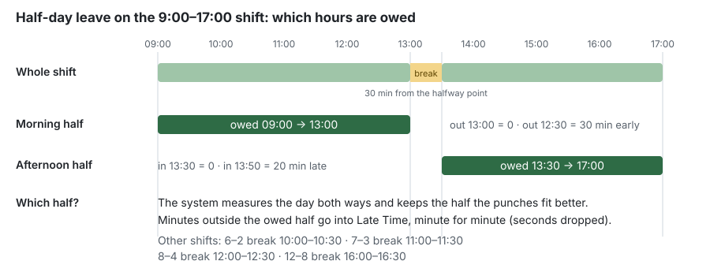

- Leaving when the break starts, or coming when it ends, costs nothing.
- Anything outside the owed half counts minute for minute in Late Time.
- The system works out which half from the punches: it measures both and keeps the one that fits better.
- A Half Day for coming **more than 2 hours late** is not leave. It is still measured against the whole shift, and counts ½ in Working Days Present.

---

## 14.6 The company closed early

**When:** everyone on a shift was sent home early (power cut, a function, a strike). People who came should get a full day.

1. Click **Close Shift Early**. A month sheet opens.
2. Pick the **Shift** that closed early. Optionally type a **Reason** for every day.
3. Use **‹ ›** to move to the month. On each day that closed early, type the time in **Closed At**, plus a reason if it differs from the one above.
4. Click **Close Days**.

Days that already have a closure show it in grey, with its number and time, as in the picture. To fill many days from Excel, use **Download Template**, fill it in, then **Import File**.

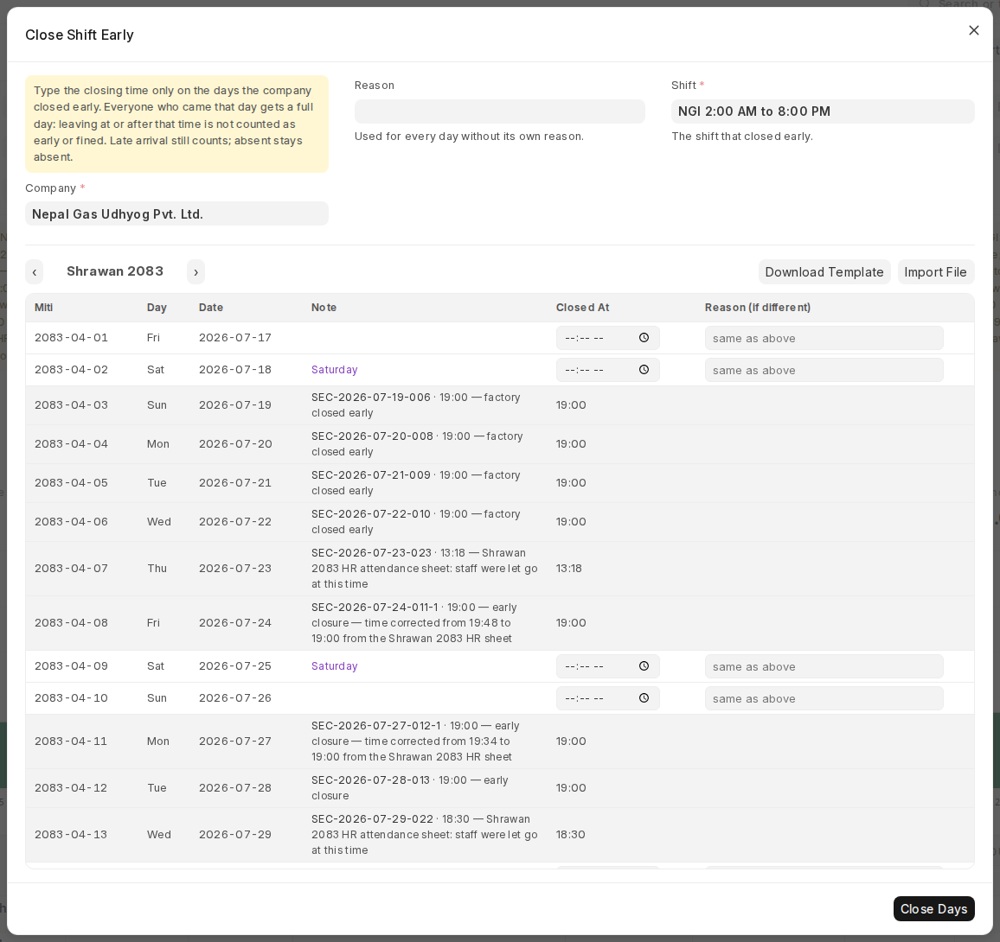

**What happens:** one **Shift Early Closure** is made per day. Leaving at or after the closing time is no longer early, so it is not fined. Leaving before it still counts, from the closing time. Late arrival still counts, and absent stays absent. The day's attendance is re-measured at once, the grid's Remarks say "Closed early at 19:00 — reason", and the yellow strip above the grid lists it.

**See, fix or undo:** click **Early Closures** for the list.

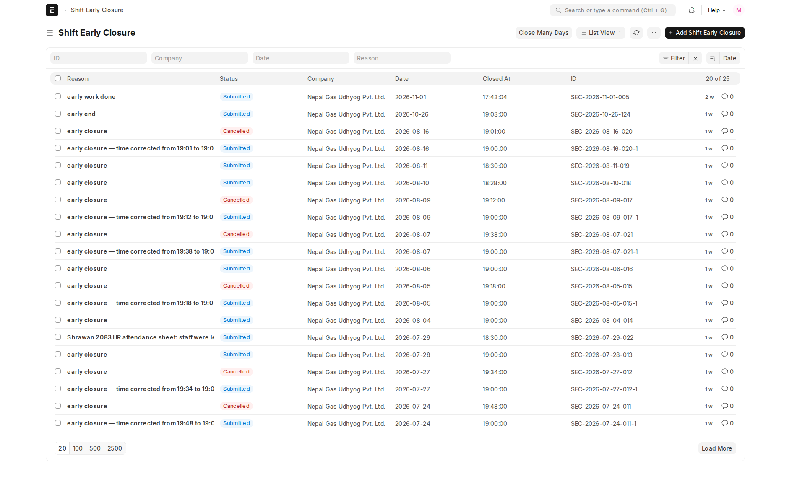

To change a closing time, open the closure and **Cancel** then **Amend** it (that is why the list shows a cancelled closure next to an "-1" one with the corrected time). To undo it altogether, just **Cancel**. Both are refused once that month's salary slip is submitted.

---

## 14.7 Staff out on official work: Field Duty

**When:** someone was away from the office on company work (bank, customs, a site visit, a delivery). From the device alone they look like they left early, or like they were absent.

1. Click **Field Duty** (it opens the Field Duty list), then **+ Add Field Duty**.
2. Choose the **Company** and type the **Reason** for the whole sheet.
3. Add one row per person per day: **Employee**, **Date**, **From**, **To**, **Place**, **Purpose**.
4. **Save**, then **Submit**.

For many rows, use **Excel → Download Template** (it lists every active employee), fill one row per day (Date in AD or Miti), then **Excel → Import from Excel**. The rows are filled in for you to check before saving.

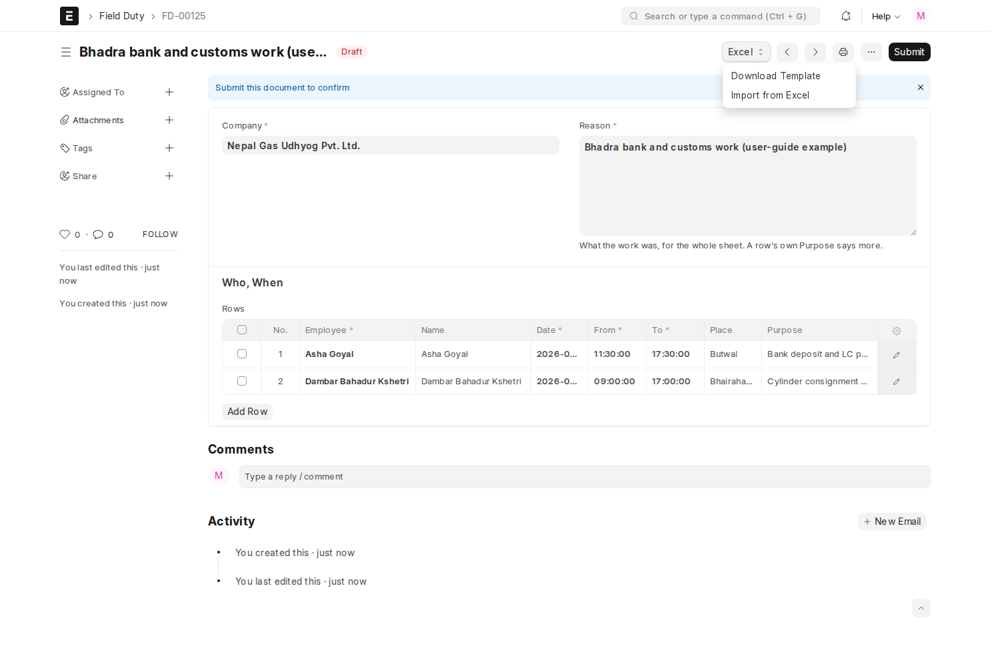

**The rule:** the hours away are added to the punches. The day is measured from the **earlier** of the first punch and From, to the **later** of the last punch and To. So the last punch is no longer the last OUT.

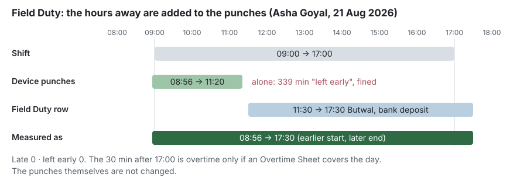

**What it looked like in the report** (the same example, submitted and then removed):

Asha Goyal punched out at 11:20 to go to the bank. Without field duty that is 339 minutes "before office time". With field duty from 11:30 to 17:30, it is 0, and Remarks say where she was:

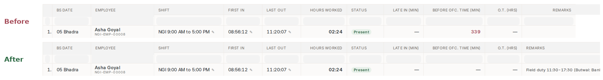

Dambar Bahadur Kshetri went straight to customs and never punched, so the day was Absent. With field duty 9:00–17:00 it is Present:

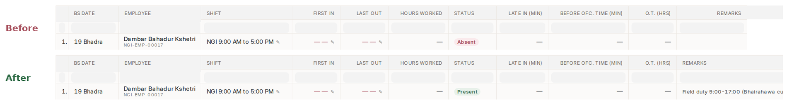

**What changes behind the scenes**

| Case | What happens on Submit |
|---|---|
| Day already Present / Half Day | Late, early and overtime re-measured from the widened times. The punches are not changed. |
| Day Absent, or not marked | Marked **Present** (an Absent is cancelled and amended). A day HRMS marks Absent later is turned Present automatically. |
| Leave day | Left as leave |
| A future day | Nothing now; it is measured when it is marked |

Field duty makes the hours **count**, but it does not **pay** overtime by itself. Overtime and meals still need an Overtime Sheet for that day ([Chapter 4](04-overtime-and-meals.md)).

**Undo:** **Cancel** the Field Duty. Days with punches go back to being measured from the punches. **Note:** for a day that had **no punch**, the cancel removes the Present it made but does not put the old Absent back. The day shows as not marked until it is re-marked; check it in the grid after cancelling.

**Refused:** a row for another company's employee; To not after From; the same person and day twice; a person already on another submitted Field Duty that day; any day inside a submitted salary slip.

---

## 14.8 Staff with no device: Import Punches

**When:** some staff sign a register instead of punching, or a device was down for a day.

1. Click **Import Punches**.
2. Click **Download Template**. It lists every active employee of the company; copy a row for each day. Columns: **Employee** (ID, or an exact name), **Employee Name**, **Date (AD)** or **Miti**, **IN**, **OUT**. Times can be 09:05, 9:05 AM or Excel times.
3. Click **Upload Sheet** and choose the file. The dialog shows the days it read and lists the lines it could not read, with the reason.
4. Check the list, keep or change the **Reason**, and click **Import**.

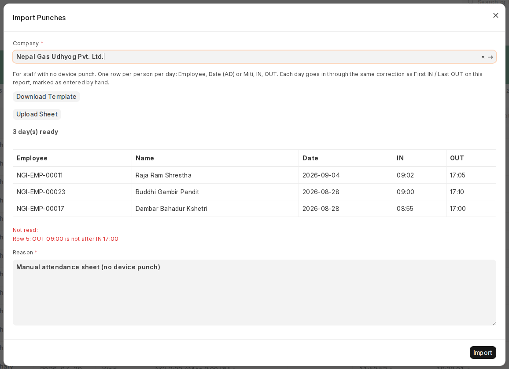

In the example, one line had the date as Miti (2083-05-12, read as 2026-08-28) and one gave only the name. Both were read. Row 5 had IN and OUT the wrong way round and was refused.

**What happens:** each day goes through exactly the same correction as clicking First IN / Last OUT ([14.3](#143-correct-a-punch-or-a-shift)). The punches are marked as entered by hand with the reason, the day is re-marked, and each day is in the Correction Log. At the end a message shows how many days went in and which were refused, and why (paid month, leave day, no shift). The rest still go in.

**Rules:** only past days. A person can't be on the same date twice in one sheet. **Undo:** correct the day again from the grid, or delete the punch on the Employee Checkin form.

---

## 14.9 Who changed what: the Correction Log

Click **Correction Log**. It opens **Attendance Correction Log**, narrowed to the report's employee and dates. The dialog's "View this day's log" link narrows it to one day.

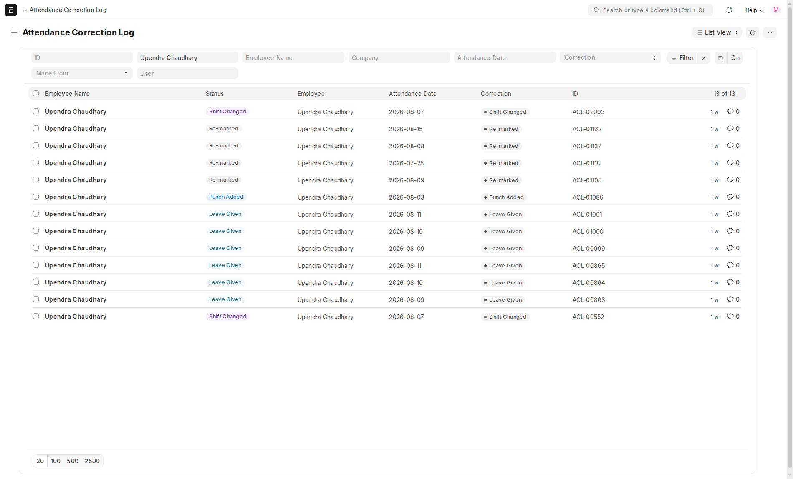

Each row is one change: **Punch Added**, **Punch Time Edited**, **Shift Changed**, **Re-marked**, **Leave Given** and so on, with before → after, the reason, who and when. Nobody can edit an entry. Only a System Manager can delete one. Changes made on the Employee Checkin form are logged here too.

---

## 14.10 Where to change the rules themselves

The buttons fix **one day**. When the rule is wrong for everybody, change it at its source:

| Rule | Where it is set | Who |
|---|---|---|
| Shift start and end times | **Shift Type** (e.g. NGI 9:00 AM to 5:00 PM) | HR Manager |
| Who is on which shift | **Shift Assignment** / **Shift Roster**, or Move Staff to This Shift ([Chapter 3.7](03-attendance-leave-holidays.md#37-changing-shifts)) | HR Manager |
| More than 2 hours late = Half Day | **Shift Type → Half Day If Late By (Hours)** | HR Manager |
| Half-day break: 30 minutes from the halfway point | In the code (`BREAK_MINUTES` in `biometric/attendance_sync.py`) | Developer |
| Minutes are whole, seconds dropped | In the code | Developer |
| Holidays and Saturdays | **Holiday List** of the employee or company; **Holiday Bulk Update** for many lists | HR Manager |
| Leave types and days per year | **Leave Allocation** / **Leave Policy** | HR Manager |
| Overtime money or replacement leave | **Employee → Overtime Eligible** / **Replacement Leave for Holiday Work** ([Chapter 2](02-employee-setup.md)) | HR Manager |
| Never fined for lateness | **Employee → Late Fine Exempt** | HR Manager |
| Overtime for a day | **Overtime Sheet** for that date ([Chapter 4](04-overtime-and-meals.md)) | HR, approved by manager |
| Meal: 1.5 hours before/after, maximum 2 | **Salary Component "Meal" → Time Offset (Hours)** and **Max Meals per Day** | HR Manager, with the accountant |
| Meal and tea rates | The employee's salary assignment, or the company default | HR Manager |
| Late fine per minute | In the code: Basic ÷ days in the BS month ÷ 8 ÷ 60 ([Chapter 5](05-monthly-payroll.md)) | Developer |
| A day with no attendance is paid as Present | **Payroll Settings → Consider unmarked attendance as** | System Manager (affects every company) |
| Biometric device and employee device ID | **Biometric Device**; **Employee → Attendance Device ID** | HR Manager |

---

## 14.11 Undo at a glance

| You did | To undo it |
|---|---|
| Corrected a punch or shift | Correct it again from the same cell |
| Excused late time | Click ✓ Excused and untick |
| Gave leave | Cancel the Leave Application |
| Closed a shift early | Early Closures → open it → Cancel |
| Field Duty | Open it → Cancel. Re-check days that had no punch |
| Imported punches | Correct the day again, or delete the punch on Employee Checkin |

Everything is refused once the month's salary slip is **submitted**. Cancel the slip first, or settle the difference with a Payroll Adjustment.

---

## 14.12 Month-end checklist on this screen

1. **Detail**, whole company, the BS month. Look in the chart for days with a lot of red (Absent).
2. Type `Absent` in the filter box under the grid's **Status** column; for each one, decide: forgot to punch (14.3), leave (14.5), official work (14.7), or really absent.
3. Look for red **— —** under Last OUT and fix them (14.3).
4. Check the yellow strip lists every early closure the factory had (14.6).
5. Make the Overtime Sheets for any extra work ([Chapter 4](04-overtime-and-meals.md)).
6. Switch to **Summary** and compare with the department heads' sheets: Present Days, Late Time, Leave, O.T.
7. Only then run payroll ([Chapter 5](05-monthly-payroll.md)).
